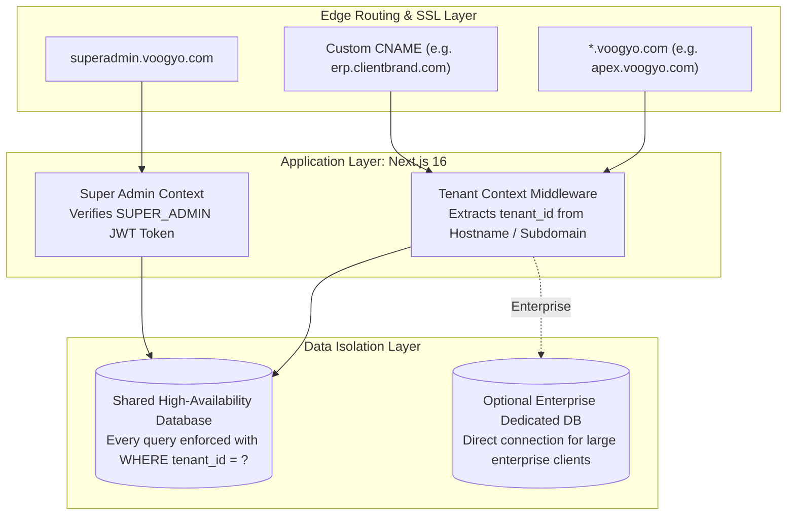

# VOOGYO — Master Project Architecture & System Blueprint

> **Product:** VOOGYO — AI-Powered Multi-Tenant Business Operating System (SaaS)  
> **Built & Owned By:** RND Technosoft  
> **Founder & Chief Architect:** Ravi Shah  
> **Product Category:** Multi-Tenant Enterprise SaaS ERP + CRM + HRMS + Operations Platform  
> **Target Audience:** Modern IT Companies, Software Agencies, Consultancies, CA Firms, and B2B Service SMEs  
> **Version:** 2.0 Production Release

---

## 1. Executive Master Directive & Vision

```markdown
You are building **Voogyo**, a premium AI-powered multi-tenant SaaS platform for service-based businesses.
Voogyo is developed and owned by RND Technosoft, but is sold as an independent commercial SaaS product.
Every customer gets a secure workspace (tenant), isolated database records, customizable branding, independent employees, clients, invoices, projects, workflows, and automation.
The platform must support thousands of companies and millions of records while maintaining enterprise-grade security, scalability, and performance.
Design every module as configurable, reusable, and industry-independent. Do not hardcode RND Technosoft-specific workflows except as optional pre-configured templates.
```

### The Core Value Proposition
Modern professional service firms juggle between 7 to 10 disjointed software tools (HubSpot/Zoho for CRM, Jira/Trello for Projects, Keka/GreytHR for HRMS, Tally/ClearTax for GST, Slack/WhatsApp for team communication, and various AI point solutions).

**Voogyo replaces this entire fragmented stack with one unified, autonomous operating system.**

```
┌─────────────────────────────────────────────────────────────────────────────┐
│                           THE VOOGYO UNIFIED SUITE                          │
├─────────────────────────────────────────────────────────────────────────────┤
│  [ SUPER ADMIN HQ ] ── Platform Command, Billing, Tenant Provisioning, CMS  │
│  [ CRM & SALES ] ── 30-Day Omnichannel Funnel, Pipelines, GST Proposals     │
│  [ HRMS & RECRUITMENT ] ── Biometric Attendance, Leaves, Onboarding, Shifts │
│  [ AGILE PROJECTS ] ── Sprints, Kanban, Timesheets, Deliverables, P&L       │
│  [ PAYROLL & TAX ] ── Indian Statutory Compliance (PF, ESIC, PT, Form 16)   │
│  [ FINANCE & GST ] ── B2B GST Invoicing, ITC Reconciliation, Expenses       │
│  [ 12 DEPARTMENTS ] ── Pre-configured agency workspaces & SOP libraries     │
│  [ 18 AI EMPLOYEES ] ── Autonomous AI CEO, CFO, Recruiter, PM, QA, etc.    │
└─────────────────────────────────────────────────────────────────────────────┘
```

---

## 2. Technical Stack & Infrastructure Architecture

Voogyo is built on a modern, high-performance, edge-ready full-stack architecture:

| Layer | Technology | Key Capabilities & Architecture |
|---|---|---|
| **Frontend Framework** | **Next.js 16 (App Router)** | Server & Client Components, Streaming SSR, dynamic layouts, zero-layout-shift navigation |
| **UI & Styling** | **React 18 + Tailwind CSS** | Component design system, Lucide React icons, dark/light mode, responsive grids |
| **Backend Runtime** | **Node.js 20+** | Next.js API Routes (`/api/v1/*`), high-throughput async processing |
| **Database & ORM** | **MySQL 8.0+ / MariaDB 10.6+** | Connection pool via `mysql2`, strict multi-tenant foreign keys, indexed query plans |
| **Authentication & RBAC**| **JWT + Bcrypt.js** | Dual authentication engine (Super Admin vs Tenant User), HTTP-only cookies, 7-day tokens |
| **File Storage & Media** | **S3-Compatible Object Store** | Cloudflare R2 / AWS S3 for documents, invoices, portfolios, and voice notes |
| **Payment Gateway** | **Razorpay Enterprise API** | UPI, Credit/Debit cards, NetBanking, auto-debit subscriptions, webhook event capture |
| **Communications** | **WhatsApp Cloud API + SMTP** | Meta WhatsApp Business Platform, Nodemailer (SendGrid / Custom SMTP), real-time alerts |
| **Spreadsheet Engine** | **ExcelJS + XLSX (SheetJS)** | Native parsing & export of `.xlsx` and `.csv` files for bulk lead and payroll operations |

---

## 3. Multi-Tenancy & Data Isolation Model

Voogyo enforces strict multi-tenancy at every architectural layer:



### The 3-Level Feature Flag Engine
Every platform capability is governed at three isolated hierarchical tiers:
1. **Level 1 (Platform Global Switch):** Super Admin can turn off features globally for system maintenance.
2. **Level 2 (Tenant Subscription Flag):** Determined by the customer's active plan tier (Starter, Growth, Pro, Enterprise) or custom contract overrides.
3. **Level 3 (Role-Based Access Control - RBAC):** Managed by the Tenant Admin within their workspace, governing whether an employee can view, create, edit, or delete specific entities.

---

## 4. Master Module Breakdown & Functional Directory

Voogyo is architected into 10 cohesive core modules:

### Module 01: Super Admin & Platform HQ Control Plane (`/super-admin`)
* **Dedicated Specification:** [`docs/MODULE_01_SUPER_ADMIN_HQ_SPECIFICATION.md`](file:///home/bhavin-pathak/project/voogyo-erp/docs/MODULE_01_SUPER_ADMIN_HQ_SPECIFICATION.md)
* **What it Does:**
  * Executive CEO command center with real-time MRR, ARR, churn rate, and module revenue breakdown.
  * Autonomous HQ AI Copilot for natural language platform queries and system diagnostics.
  * Tenant lifecycle management (Trialing, Active, Past Due, Suspended) with quota throttling (Seats, Branches, Storage, AI tokens, WhatsApp credits).
  * Zero-knowledge impersonation console for tech support with immutable audit logging.
  * Platform billing center with Razorpay gateway sync and GST invoice generation.
  * Dynamic SaaS package designer and promotional coupon engine.
  * Public website CMS, hero section copywriter, SEO analytics, and embeddable form builder.
  * Cross-tenant support ticket helpdesk and security audit logs.

### Module 02: CRM & Sales Automation Enterprise Suite (`/crm`)
* **Dedicated Specification:** [`docs/MODULE_02_CRM_ENTERPRISE_SPECIFICATION.md`](file:///home/bhavin-pathak/project/voogyo-erp/docs/MODULE_02_CRM_ENTERPRISE_SPECIFICATION.md)
* **What it Does:**
  * 30-Day Multi-Channel Outbound Marketing Funnel ("RND Gold Funnel") spanning WhatsApp, Email, LinkedIn, and Phone.
  * Dynamic objection-handling battlecards and industry-specific value propositions.
  * Multi-pipeline visual Kanban board with drag-and-drop movement, stage SLAs, and aging alerts (Yellow at 3 days, Red at 7 days).
  * 50+ field lead profile with AI lead scoring (1–100) and temperature tracking.
  * Bulk Excel/CSV import wizard with smart date parsing and duplicate detection.
  * Scheduled follow-ups, calls, and meetings with Google Meet/Zoom integration and Meeting Minutes (MoM) editor.
  * Indian GST quotation generator (Intra-State CGST+SGST, Inter-State IGST, Export LUT) with SAC codes and corporate PDF export.
  * 1-Click "Deal Won" conversion automating client account creation, client portal provisioning, project creation, and invoice drafting.
  * Tamper-proof CRM audit trail recording before/after JSON diffs for every mutation.

### Module 03: HRMS & Workforce Management (`/hrms`, `/users`)
* **What it Does:**
  * Complete employee master directory with designations, reporting managers, branches, and documents.
  * Attendance management supporting biometric device sync, web check-in/out, and geofenced mobile verification.
  * Leave management with customizable leave policies (Casual, Sick, Earned, Maternity) and multi-level approval workflows.
  * Shift scheduling and holiday calendars per branch office.
  * Employee lifecycle automation: Onboarding checklist, probation review, confirmation, appraisal, and Full & Final (F&F) exit settlement.

### Module 04: Agile Project Management & Sprints (`/projects`)
* **What it Does:**
  * Agile sprint planning, backlog grooming, and user story estimations.
  * Interactive Kanban task boards and Gantt timeline charts.
  * Granular work logs and timesheet recording linked to billing rates.
  * Milestone delivery tracking with client sign-off approvals.
  * Resource capacity planning and workload utilization heatmaps.
  * Project budget tracking, expense logging, and real-time project P&L calculations.

### Module 05: Payroll & Indian Statutory Compliance (`/payroll`)
* **What it Does:**
  * Native Indian statutory payroll calculations:
    * **Provident Fund (PF):** 12% employee + 12% employer statutory deduction with wage ceilings.
    * **Employees' State Insurance (ESIC):** 0.75% employee + 3.25% employer contributions.
    * **Professional Tax (PT):** Automated state-specific slab deductions (Gujarat, Maharashtra, Karnataka, etc.).
    * **TDS on Salaries (Section 192):** Tax regime selection (Old vs New Regime) and monthly tax deductions.
  * One-click monthly salary batch processing and automated salary slip PDF generation.
  * Annual Form 16 generator and employee tax declaration submission portal.
  * Reimbursement claims and expense approval workflows.

### Module 06: Accounts, Finance OS & GST Compliance (`/finance`)
* **What it Does:**
  * Comprehensive B2B GST-compliant invoicing with SAC/HSN codes and QR codes.
  * GSTR-1 and GSTR-3B monthly tax summary reports ready for CA filing.
  * Input Tax Credit (ITC) reconciliation ledger.
  * Vendor bill management with OCR-ready expense recording.
  * Bank transaction import and reconciliation engine.
  * Automated Accounts Receivable (AR) reminders dispatched via WhatsApp and Email.
  * Real-time Income Statement (P&L), Balance Sheet, and cash flow projections.

### Module 07: Operations Core & 12 Department Workspaces (`/operations`)
* **What it Does:**
  * Pre-configured, role-tailored digital cockpits for all 12 agency departments:
    1. *Sales Workspace*
    2. *HR Workspace*
    3. *Admin & Asset Workspace*
    4. *Finance & Invoicing Workspace*
    5. *Website Development Workspace*
    6. *Software Engineering Workspace*
    7. *SEO Operations Workspace*
    8. *Social Media Management Workspace*
    9. *Paid Ads & Media Buying Workspace*
    10. *Branding & Graphic Design Workspace*
    11. *QA & Software Testing Workspace*
    12. *Customer Support & AMC Workspace*
  * Standard Operating Procedure (SOP) library embedding agency process checklists into daily tasks.

### Module 08: Autonomous AI Digital Employees (`/ai`)
* **What it Does:**
  * 18 autonomous digital employees with role-tailored prompt personas and tool-calling capabilities:
    * **AI CEO:** Macro-health summaries, cash runway warnings, client risk analysis.
    * **AI CFO:** Cash flow forecasting, receivables pacing, expense anomalies.
    * **AI Recruiter:** Automated resume parsing, candidate scoring, scorecard drafting.
    * **AI Sales Assistant:** WhatsApp draft generation, proposal copywriter, objection battlecards.
    * **AI PM:** Standup blocker detection, sprint velocity alerts, scope-creep warnings.
    * **AI QA Engineer:** Test case generation from requirement briefs, bug report formatting.
    * **AI Media Buyer:** Ad spend pacing, CPL anomaly detection, ROAS optimization tips.
  * Vector knowledge base memory for tenant documents, guidelines, and past projects.

### Module 09: Website Engine, CMS, Forms & Pricing (`/`, `/pricing`, `/signup`)
* **What it Does:**
  * High-converting, responsive public marketing landing page (`/page.tsx`).
  * Live sync with Super Admin CMS (Announcement banner, hero headlines, CTA buttons).
  * Dynamic pricing tier display (`/pricing`) reflecting real-time plan prices and limits.
  * Automated self-service customer registration and workspace onboarding wizard (`/signup`).
  * Embeddable inbound form builder capturing leads directly into the CRM.

### Module 10: SaaS Marketplace, Ecosystem & White-Label (`/docs/10_book_saas_platform_and_marketplace`)
* **What it Does:**
  * White-label customer workspace theming (Custom logos, brand colors, custom login pages).
  * Custom domain CNAME routing with automated SSL certificates.
  * App Store & certified integrations directory (Meta Cloud API, Razorpay, Google Workspace, Slack, Tally).
  * Public REST and webhook APIs enabling custom third-party integrations.

---

## 5. Database Schema & Migration Architecture

The Voogyo database architecture is versioned through structured SQL migrations located in `/database/migrations/`:

| Migration File | Primary Functional Scope | Core Tables Introduced |
|---|---|---|
| `001_initial_voogyo_schema.sql` | Multi-tenant core, licensing, users, roles, pipelines, leads | `tenants`, `branches`, `modules`, `features`, `plans`, `plan_modules`, `tenant_subscriptions`, `roles`, `users`, `crm_pipelines`, `crm_stages`, `crm_lead_sources`, `crm_leads`, `crm_lead_activities`, `crm_lead_followups`, `departments` |
| `002_hrms_payroll_projects_finance.sql` | HRMS, payroll compliance, agile projects, invoicing | `employees`, `attendance`, `leaves`, `payroll_runs`, `payslips`, `projects`, `tasks`, `work_logs`, `invoices`, `invoice_items`, `expenses`, `bank_accounts` |
| `003_crm_enterprise_expansion.sql` | Enterprise CRM extensions, accounts, quotations, GST | `crm_clients`, `crm_services_master`, `crm_lost_reasons_master`, `crm_meetings`, `crm_quotations`, `crm_quotation_items` |
| `004_crm_templates_and_users.sql` | Reusable proposal templates and user expansion | `crm_quotation_templates`, `crm_quotation_template_items` |
| `005_platform_super_admin_schema.sql` | Super admin HQ, billing ledger, forms, coupons, logs | `super_admins`, `platform_settings`, `platform_invoices`, `platform_transactions`, `platform_activity_logs`, `platform_support_tickets`, `platform_role_templates`, `platform_invitations`, `platform_forms`, `platform_form_submissions`, `platform_email_templates`, `platform_email_logs`, `platform_subdomains`, `platform_dns_records`, `platform_coupons` |
| `006_crm_sop_masters_and_reorder.sql` | 30-day outbound SOP, reply branches, master sort orders | `crm_sop_steps_master`, `crm_sop_reply_branches_master`, `crm_sop_industries_master`, `sort_order` columns across all master tables |
| `007_tenant_organization_and_whatsapp_settings.sql` | Extended tenant organization profile and WhatsApp API | `tenant_whatsapp_settings`, extended tenant columns (`currency`, `timezone`, `tax_gstin`, `company_address`, `website_url`) |
| `008_crm_industry_and_services_update.sql` | Extended industry taxonomy and service price books | Migration scripts updating industry taxonomies and default SAC codes |
| `009_crm_lead_sub_industry.sql` | Multi-tier sub-industry classification | `sub_industry` column on `crm_leads` |
| `010_crm_conversion_channel_and_dynamic_industries.sql` | Conversion channel tracking and dynamic industry masters | `conversion_channel` on `crm_leads`, industry hook synchronization |
| `011_crm_lead_import_fields.sql` | Bulk import mapping columns | Import batch tracking and column mappings |
| `012_crm_audit_trail_activity_system.sql` | Comprehensive CRM audit trail and diff logger | `crm_audit_logs` (stores action, entity, before/after JSON diffs, actor, and IP) |

---

## 6. Global Directory & File Structure

```
voogyo-erp/
├── database/
│   └── migrations/                  # 15 SQL & JS database migrations (001 to 012)
├── docs/                            # Master System Documentation & Architectural Blueprints
│   ├── 00_VOOGYO_MASTER_PROJECT_ARCHITECTURE.md    # [THIS MASTER BLUEPRINT]
│   ├── MODULE_01_SUPER_ADMIN_HQ_SPECIFICATION.md  # Deep-dive Super Admin Guide
│   ├── MODULE_02_CRM_ENTERPRISE_SPECIFICATION.md  # Deep-dive CRM & Sales Guide
│   └── README.md                    # Master documentation index
├── public/                          # Logos, icons, and static web assets
├── src/
│   ├── app/                         # Next.js 16 App Router Pages & APIs
│   │   ├── admin/                   # Legacy admin redirect
│   │   ├── ai/                      # Autonomous AI digital employees hub
│   │   ├── api/v1/                  # RESTful API Endpoints
│   │   │   ├── auth/                # Tenant user authentication
│   │   │   ├── crm/                 # CRM endpoints (leads, quotes, meetings, cadence)
│   │   │   ├── dashboard/           # Tenant executive dashboard metrics
│   │   │   ├── finance/             # Invoices, expenses, bank accounts
│   │   │   ├── hrms/                # Employees, attendance, leaves
│   │   │   ├── projects/            # Sprints, tasks, timesheets
│   │   │   ├── super-admin/         # 25+ Platform HQ administration endpoints
│   │   │   └── users/               # Tenant user management
│   │   ├── crm/                     # Enterprise CRM frontend module
│   │   │   ├── quotations/          # Quotation builder and PDF view
│   │   │   └── page.tsx             # Main CRM multi-tab workspace
│   │   ├── dashboard/               # Tenant user dashboard
│   │   ├── finance/                 # Invoicing, GST, and accounting UI
│   │   ├── hrms/                    # HRMS, attendance, and leave management UI
│   │   ├── operations/              # 12 department workspaces and SOPs
│   │   ├── payroll/                 # Statutory payroll and salary processing UI
│   │   ├── pricing/                 # Public commercial pricing comparison page
│   │   ├── projects/                # Agile sprint boards, Kanban, and Gantt charts
│   │   ├── signup/                  # Public tenant self-service onboarding wizard
│   │   ├── super-admin/             # Super Admin Platform HQ cockpit
│   │   │   ├── login/               # Super admin isolated login page
│   │   │   └── page.tsx             # Super admin 15-view master console
│   │   ├── users/                   # Tenant employee profiles and permissions
│   │   ├── layout.tsx               # Root layout and theme provider
│   │   └── page.tsx                 # Public marketing homepage
│   ├── components/                  # Shared React UI Components
│   │   ├── crm/                     # 15 specialized CRM components (Kanban, Cadence, Drawers)
│   │   ├── super-admin/             # 22 specialized Super Admin components
│   │   ├── AppShell.tsx             # Workspace navigation wrapper
│   │   ├── Sidebar.tsx              # Dynamic module sidebar
│   │   ├── Topbar.tsx               # Global search, notifications, and user menu
│   │   └── VoogyoLogo.tsx           # Scalable SVG logo and mark
│   └── lib/                         # Core Utilities, Connectors & Services
│       ├── coldMarketingCadence.ts  # 30-Day cadence rules, templates, and objection branches
│       ├── countryCodes.ts          # International dial codes and country metadata
│       ├── crmAuditLogger.ts        # Tamper-proof audit logger with before/after diffs
│       ├── crmSopMasterService.ts   # SOP steps, reply branches, and industry service
│       ├── db.ts                    # MySQL connection pool connector
│       ├── industryTaxonomy.ts      # Multi-tier industry hooks and value propositions
│       ├── razorpay.ts              # Razorpay gateway client and webhook validator
│       └── superAdminAuth.ts        # Super Admin JWT signing, bcrypt, and auth middleware
├── package.json                     # Node.js dependencies and run scripts
├── tailwind.config.js               # Tailwind CSS theme tokens and layout styling
└── tsconfig.json                    # TypeScript strict mode configuration
```

---

## 7. Operational Workflow & Inter-Module Data Flow

The following sequence illustrates how Voogyo unifies the entire lifecycle of a customer account:

```
1. INBOUND ACQUISITION
   Public Lead submits Form on Website (/page.tsx)
        │
        ▼ (Mapped via platform_forms)
2. CRM PIPELINE & CADENCE
   Lead created in crm_leads (/crm)
   Enrolled in 30-Day Outbound Cadence (WhatsApp, Email, LinkedIn)
   Assigned via Round-Robin to Sales Rep
        │
        ▼
3. PROPOSAL & NEGOTIATION
   Sales Rep generates GST Quotation (/crm/quotations/new)
   Client approves and signs proposal
        │
        ▼ (1-Click "Deal Won")
4. OPERATIONS & PROJECT INSTANTIATION
   Account created in crm_clients
   Project created in projects table (/projects)
   Initial Milestones and Kanban tasks generated
        │
        ▼
5. HRMS & CAPACITY ALLOCATION
   Engineers assigned to project based on skill & capacity (/hrms)
   Timesheets and biometric attendance logged daily
        │
        ▼
6. FINANCE & INVOICING
   Tax Invoice generated in finance module (/finance)
   Automated GST filing summary prepared (GSTR-1)
   Payment recorded via Razorpay or Bank Wire
        │
        ▼
7. PAYROLL & STATUTORY DISBURSEMENT
   Hours logged on project feed into Monthly Payroll (/payroll)
   PF, ESIC, PT, and TDS Section 192 automatically deducted
   Payslip PDF generated for employees
        │
        ▼
8. SUPER ADMIN PLATFORM HQ
   Tenant subscription billed and monitored in Voogyo HQ (/super-admin)
   Platform telemetry, storage, and AI token limits audited
```

---

## 8. Documentation Index

For exhaustive, line-by-line functional and engineering documentation of specific modules, refer to:
* **[Book 01: Super Admin & Platform HQ Specification](MODULE_01_SUPER_ADMIN_HQ_SPECIFICATION.md)**
* **[Book 02: CRM & Sales Automation Enterprise Specification](MODULE_02_CRM_ENTERPRISE_SPECIFICATION.md)**
* **[Deployment & Workflow Operations Guide](VOOGYO_DEPLOYMENT_AND_WORKFLOW_GUIDE.md)**
