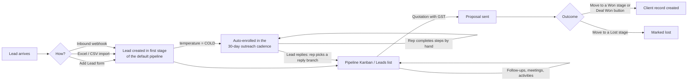

# CRM & Sales — How It Works Today

This describes the CRM & Sales module **as the code actually behaves** (September 2026), not as it was designed. The intended design is in `MODULE_02_CRM_ENTERPRISE_SPECIFICATION.md`; where the two differ, this document follows the code. Proposed improvements are in `CRM_IMPROVEMENT_PLAN.md`.

**Where the code lives**

| Layer | Files |
| --- | --- |
| API | `backend/src/modules/crm/crm.controller.ts` (routes under `/api/v1/crm`), `crm.service.ts` (~3,000 lines), `crm-cadence.helper.ts` (outreach cadence definitions) |
| Screens | `frontend/src/views/crm/CrmWorkspaceView.tsx` (the workspace shell and its tabs) and `frontend/src/components/crm/*` |
| Data | `rndtechnosoft_crm_*` tables: pipelines, stages, leads, lead activities, follow-ups, meetings, quotations and items, clients, masters (sources, services, lost reasons, industries, SOP steps and reply branches), audit logs |

Every route is tenant-scoped through the session, protected by CRM permissions (`leads.view`, `pipelines.update`, `quotations.create`…), and hidden when the workspace's CRM module is switched off.

---

## 1. The lead lifecycle at a glance

---

## 2. Setup before any lead can exist (CRM Masters)

**Screen:** CRM workspace → *Masters* tab (`CRMMastersManager.tsx`).

1. **Pipelines and stages.** A workspace needs at least one pipeline with at least one stage. Otherwise creating a lead fails with *"Create a sales pipeline with at least one stage…"* (`leadPlacement()` in `crm.service.ts`). Each stage has:
   - `sort_order`;
   - a colour;
   - `stage_probability` (percentage);
   - `sla_duration_hours`;
   - `is_won` / `is_lost` flags.
2. **Lead sources** (e.g. Website, Referral, IndiaMART), **services** (what you sell), **industries and sub-industries** (stored as JSON in tenant settings), and **lost reasons**. Lost reasons are read-only in the API; they can be listed but not created from the screen.
3. **SOP steps and reply branches** for the outreach cadence. These are also read-only; the cadence itself is defined in code (`CADENCE_STEPS_MASTER`, `CADENCE_REPLY_BRANCHES` in `crm-cadence.helper.ts`).

---

## 3. How a lead gets into the CRM

| Route in | Screen / endpoint | What happens |
| --- | --- | --- |
| Manual | *Add Lead* (`CreateLeadModal.tsx`) → `POST /crm/leads` | Needs company name, first name and a valid email. The lead is placed in the chosen pipeline and stage, or else the default pipeline's first stage. The owner is the creator. It gets a code like `LD-2026-483920`. |
| Bulk import | *Import* (`ColdLeadImportModal.tsx`) → `GET /crm/leads/import/template`, `POST /crm/leads/import` | An Excel template with drop-downs from the masters. Rows missing company, first name or email are skipped and reported back by row number. |
| Webhook | `POST /crm/leads/webhook` | Maps common field names (`company`, `sender_name`, `sender_email`, `mobile`…) and creates the lead as **HOT** in the default pipeline's first stage. It has **no owner** and records the source name only in the audit entry, not in `source_id`. |
| Demo | `POST /crm/cadence/seed` ("load sample leads") | Inserts sample outreach leads. This is demo data in a live workspace. |

**Every new lead also gets:**
- an activity *"Lead Created"* and an audit entry;
- `ai_score = 50`, `win_probability = 20`, `urgency = MEDIUM` and `budget_amount = 0` by default. These are fixed values, not calculated.

**If `temperature = COLD`**, it is automatically enrolled in the 30-day cadence (section 5).

**No duplicate check.** The same email can be created again by the form, the import or the webhook.

---

## 4. Working the pipeline

**Screen:** *Sales Pipelines* tab, with a **Kanban** view (`PipelineKanban.tsx`) and a **list** view (`LeadsDirectory.tsx`).

### Loading
The workspace loads `/crm/leads?page=1&limit=100` once, along with the first 100 follow-ups, meetings and quotations (`CrmWorkspaceView.tsx`). The Kanban columns, the list, the counts and the Reports tab are all computed **in the browser from those 100 records**.

### Moving a lead
Dragging a card to another column calls `PUT /crm/leads/:id` with the new `stageId`. The server:
- sets `stage_entered_at`;
- logs a `STAGE_CHANGE` activity;
- if the new stage is flagged **won**: sets `is_won`, `temperature = WON` and `closed_at`;
- if the new stage is flagged **lost**: sets `is_lost`, `temperature = LOST` and `closed_at`. **No lost reason is asked for**: the lead has a `lost_reason_id` column, but nothing ever fills it.

### Editing and viewing
The **Lead 360 drawer** (`Lead360Drawer.tsx`) shows and edits the profile, and lists the lead's timeline, follow-ups, meetings and quotations. It is also where the cadence and reply branches are driven from.

### Bulk actions
`POST /crm/leads/bulk` reassigns the owner, changes the stage, or deletes several leads at once.

### Deleting
Deleting a lead **hard-deletes** it together with its activities and follow-ups (`deleteLead()`).

### Export
`GET /crm/leads/export` produces an Excel file of the filtered leads.

### Values the pipeline doesn't use yet
- **Stage SLA:** `sla_duration_hours` is stored and editable, but nothing uses it. There is no overdue or "stuck" indicator.
- **Probability:** `stage_probability` is used only for the weighted value per stage (in `getPipelines()` and on the Reports tab). The lead's own `win_probability` stays at whatever was typed, 20 by default.

---

## 5. Client Outreach: the 30-day cadence

**Screen:** *Client Outreach* tab (`SLeadCadenceCenter.tsx`). **Logic:** `getCadenceMatrix()` and `executeCadenceAction()` in `crm.service.ts`, with the steps defined in `crm-cadence.helper.ts`.

1. **Enrol.** COLD leads are enrolled automatically, or the rep enrols a selection (`action: ENROLL`). The cadence state is stored as JSON in `lead.custom_attributes.cadence`: current step, the next due date, completed steps and status. The funnel name is always "RND Gold Funnel".
2. **Work the matrix.** The matrix groups leads by the step due today or overdue. Each step suggests channels (WhatsApp, email, call, LinkedIn) and an industry-specific script from `industryTaxonomy.ts`.
3. **Complete a step** (`COMPLETE_STEP`). The rep does the outreach **outside the CRM** and then marks the step done. The server:
   - appends the step to `completedSteps`;
   - calculates the next due date and increments `touchpoints_count`;
   - sets `last_contacted_at` and logs an activity.

   **Nothing is actually sent by the CRM.**
4. **When the lead replies** (`CHANGE_BRANCH`), the rep picks a reply branch (interested, not now, objection…). The cadence becomes `BRANCHED` and the temperature changes as the branch says. The CRM doesn't detect replies itself: until the rep does this, the lead keeps appearing as due.
5. After the last step, the cadence status becomes `COMPLETED`.

---

## 6. Follow-ups, meetings and activities

**Screen:** *Activities* tab (`FollowupsAndMeetings.tsx`).

**Follow-ups** (`POST /crm/followups`) have a type (call, email, WhatsApp…) and a due time, and start as `PENDING`. Creating one also sets `lead.next_followup_at`. Completing one sets `completed_at`.

**Meetings** (`POST /crm/meetings`) are a title, time, location or link, and attendees.

**Activities** (`POST /crm/activities`) are free notes on the timeline. The system also writes its own: lead created, stage changes, cadence steps, quotations and deal won.

**What's missing here:**
- **No reminders.** There is no scheduled job in the backend, so nothing notifies the rep when a follow-up falls due. The rep has to open the tab.
- **No calendar sync.** Meetings are not connected to Google or Outlook calendars.

---

## 7. Proposals and quotations

**Screen:** *Proposals* tab (`QuotationsManager.tsx`, with `WordDocumentEditor.tsx` for the covering letter).

1. A quotation is created for a lead with line items (service, quantity, unit rate). Money uses `Prisma.Decimal`, and the whole quotation is saved in one transaction.
2. **Tax:** the salesperson chooses **intra-state** (CGST 9% + SGST 9%) or **inter-state** (IGST 18%).
   - The rate is a flat **18% on the subtotal**, even though each line stores its own `tax_rate` and `sac_code`. A line at 5% or 12% would be taxed wrongly.
   - The intra/inter choice is manual, not derived from your state and the client's state.
3. It is valid for 30 days by default and gets a number like `QT-2026-xxxxxx`.
4. **Status** is a free text field, starting at `DRAFT`. There is no approval step, no "sent" or "viewed" tracking, no version history and no e-signature.

---

## 8. Winning and losing

There are two ways to win:
- **Drag to a Won stage.** The lead is only marked won (section 4); no client is created.
- **Deal Won button** (`POST /crm/leads/:id/convert-won`, `convertDealWon()`):
  1. Finds a client **with the same company name**, or creates one (`CL-2026-xxxxxx`) from the lead's contact, GSTIN and PAN.
  2. Moves the lead to *a* won stage. This is the first won stage in the workspace, even if it belongs to another pipeline.
  3. Sets `converted_client_id` and `closed_at`.
  4. Logs *"Deal Won & Client Provisioned"* with a **project code and an invoice number**. Both are just random strings made up at that moment; **no project or invoice record is created anywhere**.

These steps are not in one transaction.

**Losing:** drag to a Lost stage. No reason is captured.

---

## 9. Clients, reports and audit

**Clients** (`/crm/clients`) are created at conversion or by hand, and hold contact, billing address, GSTIN and PAN.

**Reports** (`CRMAnalytics.tsx`) show total value, won value, win rate, average deal size, the weighted forecast, value by source and the stage funnel. They are **computed in the browser from the first 100 leads**, and "value" means the lead's `budget_amount`, not a deal or quotation amount.

**Audit trail** (`CrmAuditTrailView.tsx`, `/crm/audit-logs`) records creates, updates, deletes, conversions and webhook intake with who did it and when. **Webhook audit entries store the full inbound payload**, which is personal data.

---

## 10. What already works well

- The tenant isolation, permissions, module switch and audit trail are solid foundations.
- Validation refuses leads without the essentials, and imports report skipped rows by number instead of inventing data.
- Quotations use decimal money and a transaction.
- The Kanban, the list, bulk actions, Excel import and export, and the Lead 360 drawer cover the daily basics.
- The cadence gives cold outreach a real structure, with industry scripts and reply branches.

## 11. Gaps found in the code

| # | Gap | Effect on the user |
| --- | --- | --- |
| G1 | Workspace loads only the first 100 leads, follow-ups, meetings and quotations | From the 101st lead the Kanban and list are incomplete and the reports are wrong |
| G2 | "Deal Won" makes up a project code and invoice number | Staff believe an invoice or project exists when it doesn't |
| G3 | No duplicate detection on form, import or webhook | The same person gets called twice; the reports are inflated |
| G4 | No lost reason captured, although the column and the master table exist | Nobody can say why deals are lost |
| G5 | Stage SLA hours are stored but never used | Stuck deals are invisible |
| G6 | No reminders: follow-ups rely on the rep opening the tab | Missed follow-ups |
| G7 | Cadence is manual: nothing is sent and replies aren't detected | Slow and error-prone outreach at volume |
| G8 | Webhook leads have no owner and no `source_id` | Nobody is responsible for the fastest-moving leads |
| G9 | Flat 18% GST, and intra/inter-state chosen by hand | Wrong tax on non-18% items and wrong splits |
| G10 | Quotation status is free text: no approval, viewed tracking or versions | Discounts go out unchecked; no signal of buyer interest |
| G11 | `ai_score` and `win_probability` are fixed defaults | The "AI score" suggests an insight that doesn't exist |
| G12 | Deleting a lead hard-deletes its history | Lost audit context and reporting history |
| G13 | The won stage is picked workspace-wide, and conversion isn't one transaction | Can land in the wrong pipeline, or half-convert |
| G14 | Webhook audit entries store the full payload | Unneeded personal data kept (DPDP) |
| G15 | The "load sample leads" demo seeding is available in live workspaces | Fake leads mixed into real data |
