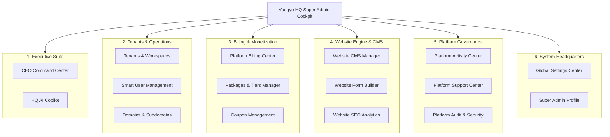

# Voogyo Master Specification — Book 01: Super Admin & Platform HQ Control Plane

> **Document Version:** 2.0 Enterprise Release  
> **Classification:** Platform-Level Master Specification  
> **Author:** RND Technosoft Engineering Architecture Team  
> **Target Audience:** Platform Engineers, SaaS Architects, DevOps, Product Leadership  
> **Source Base:** `/src/app/super-admin`, `/src/app/api/v1/super-admin`, `/database/migrations/005_platform_super_admin_schema.sql`

---

## 1. Executive Summary & Platform Purpose

**Voogyo HQ (`/super-admin`)** is the centralized, high-security operational command plane for the entire Voogyo Multi-Tenant SaaS platform. Developed and maintained by **RND Technosoft**, Voogyo HQ empowers platform owners, cloud engineers, and customer success teams to manage thousands of client companies (tenants), govern subscriptions, monitor telemetry, enforce system security, adjust commercial pricing packages, manage public CMS & SEO assets, and resolve enterprise support tickets from a single unified cockpit.

### Core Architectural Mandates
1. **Logical & Physical Isolation:** The Super Admin control plane is completely isolated from regular tenant traffic. Standard tenant users and workspace administrators cannot discover or access Super Admin routes or APIs.
2. **Multi-Tenant Sovereign Governance:** Complete lifecycle management over every tenant organization: self-service trial, custom plan provisioning, suspension, resource quotas, and zero-knowledge impersonation.
3. **Monetization & Commercial Control:** Integrated billing engine backed by Razorpay, automated GST invoicing, transaction tracking, dynamic package tiering, and promotional coupon engine.
4. **Autonomous AI Platform Copilot:** Natural language AI assistant built into HQ for real-time querying of platform metrics, database telemetry, ARR forecasting, and tenant health audits.
5. **Edge & CMS Management:** Control over landing page copy, promotional announcement banners, SEO metadata, embeddable inbound lead capture forms, and GoDaddy custom domain DNS routing.

---

## 2. Super Admin Security & Authentication Architecture

### 2.1 Credential & Session Management (`src/lib/superAdminAuth.ts`)
The Super Admin platform uses a dedicated authentication pipeline distinct from tenant user authentication:
* **Account Storage:** Dedicated table `super_admins` storing bcrypt-hashed passwords (cost factor 10).
* **JWT Signing & Verification:** Signed using `SUPERADMIN_JWT_SECRET` with a 7-day token lifecycle.
* **Dual Header & Cookie Verification:** API routes automatically extract and verify identity from:
  1. `Authorization: Bearer <token>` HTTP header.
  2. `voogyo_superadmin_token` HTTP-only, secure cookie.
* **Database Verification:** Every authenticated request verifies that the `super_admins` record has `is_active = 1`.
* **Zero-Knowledge Impersonation:** Super admins can initiate temporary, audited impersonation sessions into any tenant workspace without knowing or resetting the customer's password.

```
┌─────────────────────────────────────────────────────────────────────────────┐
│                    SUPER ADMIN AUTHENTICATION FLOW                          │
└─────────────────────────────────────────────────────────────────────────────┘
  Super Admin Browser
         │
         │  POST /api/v1/super-admin/auth/login { email, password }
         ▼
  [Next.js API Handler: superAdminAuth.ts]
         │
         ├── 1. Query: SELECT * FROM super_admins WHERE email = ? AND is_active = 1
         ├── 2. Verify: bcrypt.compare(password, password_hash)
         ├── 3. Sign: jwt.sign(payload, SUPERADMIN_JWT_SECRET, { expiresIn: '7d' })
         ├── 4. Set-Cookie: voogyo_superadmin_token=<JWT>; HttpOnly; SameSite=Lax
         └── 5. Log activity in platform_activity_logs (Category: AUTH, Actor: SUPER_ADMIN)
         │
         ▼
  Access granted to /super-admin Cockpit
```

---

## 3. Super Admin UI Module Map & Navigation

The Super Admin cockpit (`/src/app/super-admin/page.tsx`) organizes 15+ sub-modules into 6 functional suites:



---

## 4. Deep-Dive Specification of All 15+ Sub-Modules

### 4.1 Executive Suite

#### A. CEO Command Center (`overview` / `ExecutiveDashboardView.tsx`)
The platform command dashboard gives executive leadership real-time visibility across the entire SaaS business:
* **Core KPI Metrics:**
  * **Total Tenants:** Active count, trial count, suspended count, and monthly growth percentage.
  * **MRR (Monthly Recurring Revenue):** Aggregated monthly recurring billings in INR.
  * **ARR (Annual Recurring Revenue):** Annualized revenue projection.
  * **Net Churn Rate:** Percentage of canceled or expired subscriptions vs renewals.
  * **Active System Users:** Total active registered users across all client companies.
  * **Database & Worker Health:** Real-time MySQL connection pool latency and background job throughput.
* **Revenue Breakdown by Module:** Visual chart breaking down income derived from:
  1. CRM & Sales Automation Pro
  2. Projects & Operations Suite
  3. Indian Statutory Payroll
  4. Autonomous AI Digital Employee Copilots
  5. WhatsApp Messaging Credits
* **Tenants by Industry Distribution:** Real-time pie/donut chart classifying clients across:
  * Digital Marketing & Creative Agencies
  * IT & Software Development Firms
  * Chartered Accountants & Financial Consultancies
  * Architecture & Professional Services
* **Quick Action Controls:** Immediate buttons to provision a company, launch AI health scan, dispatch global system announcement, or review unpaid invoices.

#### B. HQ AI Copilot (`assistant` / `SuperAdminAiAssistantView.tsx`)
An autonomous conversational digital employee dedicated to platform leadership:
* **Contextual Data Querying:** Natural language queries such as:
  * *"Which tenants have consumed more than 80% of their AI token quota this month?"*
  * *"Show me all tenants whose subscriptions expire within the next 7 days."*
  * *"What is our projected MRR growth for next quarter based on current trial conversions?"*
* **Incident Troubleshooting:** Super Admins can paste error logs or report slow queries, and the assistant suggests index optimizations or analyzes query plans.
* **Automated System Auditing:** 1-click execution to scan for uncollected invoices, missing DNS propagation, or dormant trial workspaces.

---

### 4.2 Tenants & Operations Suite

#### A. Tenants & Workspaces Manager (`tenants`)
The core registry for all customer companies using Voogyo:
* **Status Lifecycle Management:**
  * `TRIALING`: 14-day evaluation period with restricted quotas.
  * `ACTIVE`: Paying customer in good standing with active subscription.
  * `PAST_DUE`: Payment failed; 7-day grace period with warning banner displayed in tenant portal.
  * `SUSPENDED`: Workspace locked due to non-payment or terms violation. Read-only access or total login block.
* **Quota Allocation & Throttling:**
  * **User Seats Limit:** Maximum number of employee profiles that can be created (e.g., 5, 25, 100, Unlimited).
  * **Branch Offices Limit:** Multi-branch ceiling (Headquarters, Regional offices).
  * **Storage Limit (MB):** S3 / local object storage disk quota (e.g., 5,120 MB to 1,000,000 MB).
  * **Monthly AI Token Quota:** DeepMind / OpenAI token ceiling for digital employee agents.
  * **Monthly WhatsApp Credits:** Ceiling for outbound template broadcasts and transactional alerts.
* **Dedicated Database Routing:** Enterprise tenants can be configured with a dedicated remote database connection URL (`dedicated_db_connection_url`), routing their queries off the shared cluster.
* **Zero-Knowledge Impersonation:** Secure 1-click launch into the customer's portal with full audit logging, allowing tech support to diagnose client issues without requesting passwords.

#### B. Smart User Management (`invited-users` / `SmartUserManagementView.tsx`)
Unified management across all users in the ecosystem:
* **Invited Users Sub-View:**
  * Tracks pending email invitations (`platform_invitations`).
  * Invitation token expiry management (default 7 days).
  * 1-Click "Resend Invitation" or "Revoke Invitation".
* **Registered Users Sub-View (`registered-users`):**
  * Search across all employee accounts across all tenants.
  * Filter by Tenant, Role, Branch, or Status (Active / Inactive).
  * 1-Click remote lock or password reset dispatch.
* **Workspace Administrators Sub-View (`workspace-admins`):**
  * Dedicated directory of primary account owners for each client firm.
  * Contact info (Phone, Email, Designation) and direct WhatsApp messaging trigger.

#### C. Tenant Roles & Permissions Builder (`roles-templates` / `TenantRolesBuilderView.tsx`)
Global repository of standardized Role-Based Access Control (RBAC) blueprints:
* **System Templates:** Pre-configured roles (`OWNER`, `HR_MANAGER`, `SALES_DIRECTOR`, `PROJECT_MANAGER`, `ACCOUNTANT`, `TEAM_MEMBER`).
* **Permissions Matrix Editor:** Granular checkboxes across every entity in Voogyo:
  * `View`, `Create`, `Edit`, `Delete`, `Export`, `Approve`, `Manage Settings`.
* **Inheritance & Tenant Distribution:** Updating a platform role template can automatically push updates or serve as the seed template when new tenants are provisioned.

#### D. Domains & Subdomains Manager (`domains` / `DomainSubdomainManagerView.tsx`)
Governs DNS routing and white-label custom domain mappings:
* **Subdomain Registry (`platform_subdomains`):**
  * Tracks all `*.voogyo.com` tenant endpoints.
  * Automatic health check and SSL certificate validity monitoring.
* **Custom CNAME Domains:**
  * Allows enterprise tenants to use their own branded domain (e.g., `erp.clientagency.com`).
  * Automated DNS verification against GoDaddy API / Cloudflare Edge.
  * Automatic generation of required CNAME target records: `cname.voogyo.com`.
* **DNS Records Master (`platform_dns_records`):**
  * Live monitoring of A, CNAME, MX, and TXT verification records.

---

### 4.3 Monetization & Commercials Suite

#### A. Platform Billing Center (`billing` / `PlatformBillingCenterView.tsx`)
The unified financial hub for SaaS subscription billing:
* **Invoices Sub-Module (`TenantInvoicesView.tsx` & `InvoiceDetailModal.tsx`):**
  * Tracks all B2B subscription tax invoices generated for tenants (`platform_invoices`).
  * Automatic calculation of GST:
    * Intra-State Gujarat: CGST 9% + SGST 9%.
    * Inter-State: IGST 18%.
  * Status tracking: `PAID`, `PENDING`, `OVERDUE`, `VOID`.
  * PDF generation and download with RND Technosoft corporate letterhead and GSTIN (`24AAACV1234F1Z8`).
* **Transactions Sub-Module (`TenantTransactionsView.tsx`):**
  * Complete ledger of payment gateway attempts (`platform_transactions`).
  * Captured vs Failed audit trail with Gateway Error Descriptions.
  * Payment modes tracked: UPI, Credit/Debit Cards, Net Banking, EMI, Corporate Wallets.
  * 1-Click refund authorization with transaction logs.
* **Subscriptions Sub-Module (`subscriptions`):**
  * Current plan, active billing cycle (Monthly / Annual), renewal dates, auto-debit status.
  * 1-Click plan upgrade/downgrade override for enterprise account managers.

#### B. Payment Gateway Configuration (`payment-gateway` / `PaymentGatewayView.tsx`)
Native integration settings with Razorpay:
* **Key Management:** Encrypted storage of `razorpay_key_id`, `razorpay_key_secret`, and `razorpay_webhook_secret`.
* **Environment Switch:** Instant toggle between `test` mode and `production` live mode.
* **Auto-Capture Controls:** Immediate capture vs manual authorization for enterprise wire transfers.
* **Webhook Health:** Live ping test verifying webhook delivery for `subscription.charged`, `payment.failed`, and `refund.processed`.

#### C. Dynamic Packages & Tiers Manager (`packages` / `PackagesManagerView.tsx`)
A flexible SaaS plan designer enabling monetization agility without code changes:
* **Tier Definition:** Configure plans like `Starter`, `Professional`, `Growth`, `Enterprise`, or `Custom Agency Retainer`.
* **Pricing Engine:** Monthly price (cents/INR), annual discount percentage (e.g. 20% off for annual commitment).
* **Resource Ceiling Sliders:**
  * Maximum Users / Seats
  * Maximum Branch Offices
  * Storage Allotment (MB)
  * WhatsApp Message Credits per Month
  * AI LLM Tokens per Month
* **Feature Access Matrix:** Enable/disable specific modules per plan:
  * B2B Sales CRM & Omnichannel Cadence
  * Agile Projects, Kanban & Work Logs
  * Biometric HRMS & Geofenced Attendance
  * Statutory Indian Payroll (PF, ESIC, Form 16)
  * GST Invoicing, E-Way Bills & Balance Sheet
  * Autonomous AI Copilots & Custom Integrations
* **Public Visibility Toggle:** Publish or hide plans from the public `/pricing` page.

#### D. Coupon Management (`coupons` / `CouponManagementView.tsx`)
Promotional campaign and discount engine:
* **Coupon Attributes (`platform_coupons`):**
  * Code: e.g. `LAUNCH2026`, `DIWALI50`, `AGENCYPRO`.
  * Discount Type: `PERCENTAGE` (e.g. 25% off) or `FLAT` (e.g. ₹5,000 off).
  * Validity Window: Start Date and Expiry Date.
  * Usage Constraints: Maximum total redemptions vs Times used.
* **Value-Added Bonuses:** Coupons can grant perks beyond cash discounts:
  * Bonus Free Trial Days (+14 days).
  * Extra AI Tokens (+500,000 tokens).
  * Extra Storage (+20,000 MB).
  * Extra Included Employee Seats (+5 seats).
* **Plan Restrictions:** Selectively apply coupons to specific subscription tiers.

---

### 4.4 Website Engine & Inbound Marketing Suite

#### A. Website CMS Manager (`website-cms` / `WebsiteCmsManagerView.tsx`)
Empowers non-technical marketing executives to update the public marketing site (`/page.tsx`) without code commits:
* **Global Announcement Banner:**
  * Toggle Active / Inactive.
  * Announcement text (e.g. *"🚀 Voogyo OS 2.0 Released: Autonomous AI Employees & Unified GST Invoicing!"*).
  * Direct CTA link target (e.g. `/signup`).
* **Hero Section Copywriter:**
  * Hero Section Badge text.
  * Primary H1 Heading Line 1 & Line 2.
  * Subheading pitch description.
  * Primary CTA Button text and URL (`Start 7-Day Free Trial` -> `/signup`).
  * Secondary CTA Button text and URL (`Explore Live Demo` -> `/login`).
* **Instant Propagation:** Changes saved here write directly to `platform_settings` and update the live website immediately.

#### B. Website Form Builder & Inbound Lead Engine (`form-builder` / `WebsiteFormBuilderView.tsx`)
A drag-and-drop form builder for lead generation:
* **Form Schema Designer (`platform_forms`):**
  * Custom fields (Text, Email, Phone, Dropdown, Textarea, Budget slider).
  * Form validation rules (Required, regex, length constraints).
* **Direct CRM Lead Auto-Mapping:**
  * Automatically maps inbound submissions into `crm_leads` for a designated tenant.
  * Assigns default Lead Source (e.g. `Website Inbound Contact`), default Pipeline, and Initial Stage.
  * Triggers immediate round-robin sales assignment.
* **Alert Webhooks & Instant Notifications:**
  * Sends instant email alert to sales executives upon submission.
  * Sends instant WhatsApp notification to sales management.
  * Dispatches outgoing webhook to external endpoints (Zapier, Slack).
* **Inbound Submissions Ledger (`platform_form_submissions`):**
  * Complete searchable audit of every payload, timestamp, submitter IP address, and user agent.

#### C. Website SEO & Analytics (`seo-analytics` / `WebsiteSeoAnalyticsView.tsx`)
Complete platform-level search engine optimization controls:
* **Meta Tags Management:**
  * Meta Title, Meta Description, and Targeted Search Keywords.
  * Canonical URL (`https://voogyo.com`).
  * OpenGraph (OG) Social Share Image URL.
  * Robots Indexation Directives (`index, follow` vs `noindex`).
* **Tracking & Analytics Tags:**
  * Google Analytics 4 Measurement ID (`G-VOOGYO2026`).
  * Google Search Console HTML Meta Verification Token.
  * Meta Pixel ID for Facebook/Instagram retargeting.

---

### 4.5 Platform Governance & Security Suite

#### A. Platform Activity Center (`activity-center` / `PlatformActivityCenterView.tsx`)
The centralized, tamper-proof activity audit stream (`platform_activity_logs`):
* **Severity Levels:**
  * `INFO`: Routine operations (e.g., plan created, coupon redeemed, user invited).
  * `WARNING`: Non-critical anomalies (e.g., payment retry scheduled, storage at 90%).
  * `ERROR`: Critical operational failures (e.g., Razorpay webhook signature mismatch).
  * `CRITICAL`: Security alerts (e.g., multiple failed super admin logins, IP block).
* **Search & Filters:** Real-time filtering by Tenant, Category (`SYSTEM`, `BILLING`, `AUTH`, `TENANT`), Date Range, and Actor.
* **Context Metadata:** Full JSON metadata capture including IP Address, Browser, and Session ID.

#### B. Platform Support Center (`support` / `PlatformSupportCenterView.tsx`)
Cross-tenant helpdesk ticket inbox (`platform_support_tickets`):
* **Ticket Ingestion:** Automatically captures issues submitted by tenant admins from their workspace helpdesk widget.
* **Ticket Metadata:** Ticket Number (`TKT-2026-XXXX`), Company Name, Submitter Email/Phone, Category (`BILLING`, `BUG`, `FEATURE_REQUEST`, `INTEGRATION`), Priority (`LOW`, `NORMAL`, `HIGH`, `URGENT`).
* **Resolution Workflow:** Assign to engineering lead, update status (`OPEN`, `IN_PROGRESS`, `WAITING_ON_CLIENT`, `RESOLVED`, `CLOSED`), and record internal resolution notes.

#### C. Platform Audit & Security (`audit-security` / `PlatformAuditSecurityView.tsx`)
Security event monitor safeguarding platform integrity:
* **Super Admin Login Logs:** Tracks every login with timestamp, IP address, and geographic location.
* **Impersonation Log Ledger:** Immutable record of every zero-knowledge impersonation session, recording who logged into which tenant workspace, timestamp, and stated business reason.
* **Failed Authentication Alerts:** Tracks brute-force attempts and flags suspicious IP subnets for blacklisting.

---

### 4.6 System Headquarters Suite

#### A. Global Settings Center (`settings` / `GlobalSettingsCenterView.tsx`)
Master platform configuration repository:
* **Platform Branding & Identity:** Company Name, Tagline, Official Address, Corporate GSTIN, Support Email, Support Phone, Brand Logo, Wordmark, and Favicon URL.
* **SMTP Email Gateway Configuration:**
  * SMTP Host (e.g. `smtp.sendgrid.net`), Port (`587` / `465`), Username, Password / API Key.
  * Encryption (`TLS` / `SSL`).
  * Default Sender Name (`Voogyo Enterprise Cloud`) & Sender Email (`no-reply@voogyo.com`).
  * "Send Test Email" tool to verify delivery directly from the UI.
* **Email Template Studio (`platform_email_templates`):**
  * Manage templates for: `TENANT_WELCOME`, `INVITATION_EMAIL`, `PASSWORD_RESET`, `INVOICE_GENERATED`, `PAYMENT_FAILED`, `QUOTA_EXCEEDED_WARNING`.
  * Dynamic template variables (e.g., `{{company_name}}`, `{{invitation_link}}`, `{{amount}}`).

#### B. Super Admin Profile (`profile` / `SuperAdminProfileView.tsx`)
Personal security settings for the logged-in super administrator:
* View name, email, role, and last login timestamp.
* Change Super Admin password (enforces 10+ character complexity).
* Configure two-factor authentication (2FA) preferences.

---

## 5. Super Admin Database Schema Architecture

The Super Admin platform is backed by 12 core tables created in `/database/migrations/005_platform_super_admin_schema.sql`:

| Table Name | Primary Purpose | Key Fields |
|---|---|---|
| `super_admins` | Super administrator user credentials and system roles | `id`, `full_name`, `email`, `password_hash`, `role`, `is_active`, `last_login_at` |
| `platform_settings` | Global key-value store for branding, SEO, SMTP, and Razorpay | `setting_key`, `setting_group`, `setting_value`, `is_public` |
| `platform_invoices` | B2B GST subscription invoices issued to client companies | `id`, `invoice_number`, `tenant_id`, `subtotal_amount`, `cgst_amount`, `sgst_amount`, `igst_amount`, `total_amount`, `status` |
| `platform_transactions` | Payment gateway transaction history and audit records | `id`, `transaction_number`, `tenant_id`, `invoice_id`, `gateway`, `amount`, `payment_mode`, `status`, `gateway_response` |
| `platform_activity_logs` | Immutable audit trail of all platform-level administrative actions | `id`, `tenant_id`, `category`, `severity`, `title`, `description`, `actor_type`, `actor_name`, `metadata_json`, `ip_address` |
| `platform_support_tickets`| Cross-tenant customer support ticket desk | `id`, `ticket_number`, `tenant_id`, `company_name`, `subject`, `description`, `priority`, `status`, `assigned_to` |
| `platform_role_templates` | Pre-configured RBAC templates for tenant workspaces | `id`, `name`, `code`, `description`, `department`, `permissions_json`, `is_system` |
| `platform_invitations` | Pending employee invitations across all tenant workspaces | `id`, `tenant_id`, `email`, `role_id`, `role_name`, `token`, `status`, `expires_at` |
| `platform_forms` | Inbound marketing form schemas and CRM routing rules | `id`, `form_key`, `title`, `fields_json`, `crm_lead_mapping_json`, `notify_email_recipients`, `is_active` |
| `platform_form_submissions`| Raw capture of all public website form submissions | `id`, `form_key`, `data_json`, `ip_address`, `user_agent`, `created_at` |
| `platform_email_templates`| Transactional and system email templates | `id`, `name`, `code`, `category`, `subject`, `body_html`, `placeholders_json`, `is_active` |
| `platform_email_logs` | Delivery log of all outgoing system emails | `id`, `template_id`, `recipient_email`, `subject`, `status`, `error_message`, `sent_at` |
| `platform_subdomains` | Tenant subdomain routing and SSL validity ledger | `id`, `tenant_id`, `subdomain`, `status`, `ssl_status` |
| `platform_dns_records` | Custom CNAME and DNS verification records | `id`, `domain_name`, `record_type`, `host`, `value`, `ttl`, `status` |
| `platform_coupons` | Promotional discount and credit bonus coupons | `id`, `code`, `discount_type`, `discount_value`, `max_uses`, `times_used`, `bonus_ai_tokens`, `valid_until` |

---

## 6. Super Admin REST API Reference

All Super Admin APIs are hosted under `/api/v1/super-admin/*` and require Super Admin authorization:

```
┌────────────────────────────────────────────────────────────────────────────────────────┐
│                        SUPER ADMIN REST API DIRECTORY                                  │
├────────────────────────┬─────────┬─────────────────────────────────────────────────────┤
│ Endpoint               │ Method  │ Functionality                                       │
├────────────────────────┼─────────┼─────────────────────────────────────────────────────┤
│ /auth/login            │ POST    │ Authenticate Super Admin, issue JWT & set cookie    │
│ /auth/me               │ GET     │ Fetch current Super Admin profile & permissions     │
│ /auth/logout           │ POST    │ Invalidate session and clear auth cookie            │
│ /dashboard             │ GET     │ Aggregate KPI metrics, MRR/ARR, tenant stats        │
│ /ai-assistant          │ POST    │ Dispatch prompt to Super Admin AI Copilot           │
│ /tenants               │ GET     │ List all tenant organizations with search & filters │
│ /tenants               │ POST    │ Provision a new tenant workspace manually           │
│ /tenants/[id]          │ GET/PUT │ Fetch or update tenant details & resource quotas    │
│ /tenants/[id]/status   │ PUT     │ Update tenant status (ACTIVE, SUSPENDED, TRIALING)  │
│ /tenants/[id]/impersonate│ POST  │ Generate zero-knowledge audited login session       │
│ /billing               │ GET     │ Aggregate revenue metrics, unpaid invoices, totals  │
│ /invoices              │ GET/POST│ List or manually issue a B2B platform tax invoice   │
│ /invoices/[id]         │ GET     │ Fetch full invoice breakdown with tax details       │
│ /transactions          │ GET     │ List payment gateway transactions with filters      │
│ /transactions/[id]/refund│ POST  │ Process partial or full transaction refund          │
│ /packages              │ GET/POST│ List or create commercial subscription plans        │
│ /packages/[id]         │ PUT/DEL │ Update plan pricing, limits, and feature matrix     │
│ /coupons               │ GET/POST│ List or create promotional coupon codes             │
│ /coupons/[id]          │ PUT/DEL │ Update or deactivate promotional coupon             │
│ /domains               │ GET/POST│ List and register custom CNAME domains              │
│ /domains/verify        │ POST    │ Trigger live DNS verification for a domain          │
│ /settings              │ GET/POST│ Fetch or bulk-update global platform settings       │
│ /settings/branding     │ PUT     │ Update logo, mark, favicon, and company info        │
│ /settings/smtp         │ PUT     │ Update SMTP gateway credentials & test connection   │
│ /settings/razorpay     │ PUT     │ Update Razorpay gateway keys and webhook secrets    │
│ /email/send-test       │ POST    │ Dispatch test email via configured SMTP gateway     │
│ /forms                 │ GET/POST│ Manage website inbound lead capture forms           │
│ /forms/submissions     │ GET     │ View inbound submissions with CRM lead links        │
│ /roles-templates       │ GET/POST│ Manage standard RBAC permission templates           │
│ /invited-users         │ GET     │ List pending invitations across all tenants         │
│ /invited-users/[id]/resend│ POST │ Resend invitation email with refreshed token        │
│ /support               │ GET/POST│ View support tickets or reply to tenant ticket      │
│ /activity              │ GET     │ Query system-wide audit activity logs               │
│ /security/logs         │ GET     │ Query security events and impersonation logs        │
│ /profile/change-password│ POST   │ Update logged-in super admin password               │
└────────────────────────┴─────────┴─────────────────────────────────────────────────────┘
```

---

## 7. Super Admin Operational Playbooks

### Playbook 1: Provisioning a New Enterprise Tenant
1. Navigate to **Tenants & Workspaces** (`/super-admin?view=tenants`).
2. Click **+ Provision New Tenant**.
3. Enter Organization Name (e.g. `Acme Digital Corp`), Subdomain slug (`acme` -> `acme.voogyo.com`), Primary Contact details, and Industry.
4. Select Subscription Plan (e.g. `Enterprise Tier`) or override custom quotas:
   * Seats: `150`
   * Branches: `5`
   * Storage: `100,000 MB`
   * AI Tokens: `5,000,000`
   * WhatsApp Credits: `25,000`
5. Specify if tenant requires a **Dedicated Database URL**.
6. Submit: The provisioning worker creates the tenant record, seeds default departments, pipelines, and roles, and sends an activation email to the primary admin.

### Playbook 2: Troubleshooting a Tenant Issue via Impersonation
1. Navigate to **Tenants & Workspaces**.
2. Locate the tenant via Search (by Company Name, Subdomain, or GSTIN).
3. Click **Impersonate Workspace**.
4. Enter the mandatory **Support Ticket ID** and **Business Justification Reason**.
5. The system logs an immutable entry in `platform_activity_logs` and `impersonation_logs`.
6. A temporary scoped session opens in a new tab, allowing the engineer to reproduce and resolve the client's issue.
7. Upon closing the tab, the impersonation session terminates automatically.

### Playbook 3: Emergency Tenant Suspension
1. Open the tenant profile in **Tenants & Workspaces**.
2. Under Status Control, select **SUSPENDED**.
3. Select the reason: *Non-Payment*, *Terms of Service Violation*, or *Security Quarantine*.
4. Submit: The tenant's active sessions are invalidated immediately, and all subsequent API requests for that tenant return `403 Forbidden (Workspace Suspended)`.
