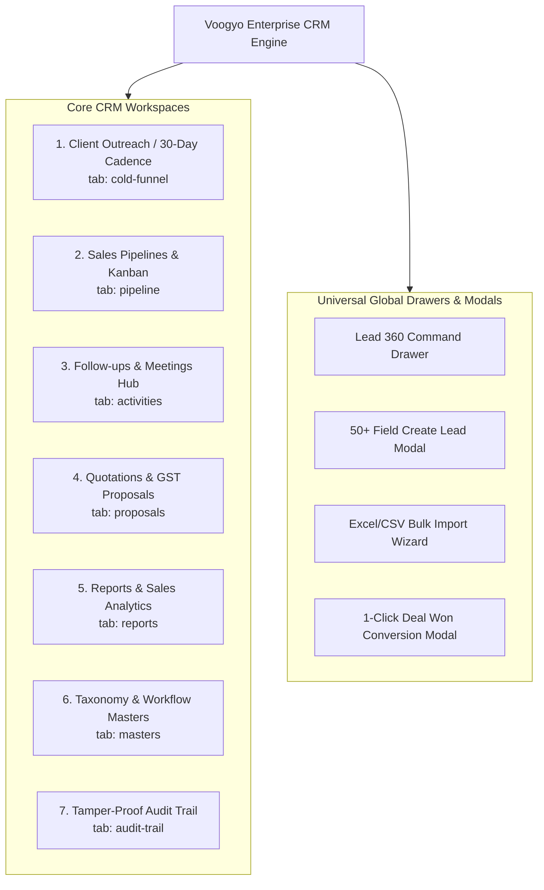

# Voogyo Master Specification — Book 02: CRM & Sales Automation Enterprise Module

> **Document Version:** 2.0 Enterprise Release  
> **Classification:** Core Product Module Specification  
> **Author:** RND Technosoft Engineering Architecture Team  
> **Target Audience:** Full-Stack Engineers, Product Managers, Revenue Operations, Sales Leadership  
> **Source Base:** `/src/app/crm`, `/src/components/crm`, `/src/app/api/v1/crm`, `/src/lib/coldMarketingCadence.ts`, `/src/lib/crmAuditLogger.ts`, `/database/migrations/001_initial_voogyo_schema.sql`, `/database/migrations/003_crm_enterprise_expansion.sql`, `/database/migrations/006_crm_sop_masters_and_reorder.sql`, `/database/migrations/012_crm_audit_trail_activity_system.sql`

---

## 1. Executive Summary & Module Philosophy

**Voogyo CRM** is a multi-tenant, omnichannel customer relationship and sales pipeline platform built specifically for service-oriented businesses—including IT software development agencies, digital marketing consultancies, design studios, and professional service firms.

### Core Value Pillars
1. **Zero Lead Leakage:** Sub-5-minute response SLA via automated multi-source lead ingestion (Meta Lead Ads, Google Ads, IndiaMART, JustDial, website webhooks, and inbound emails).
2. **The "RND Gold Funnel" (30-Day Multi-Channel Outreach):** A structured, battle-tested 8-touchpoint outbound cadence across WhatsApp, Email, LinkedIn, and Phone calls with industry-specific value propositions and dynamic objection-handling scripts.
3. **Multi-Pipeline Visual Kanban:** Drag-and-drop opportunity tracking with stage-specific SLAs, visual deal aging alerts (Yellow at 3 days, Red at 7 days), and weighted revenue forecasting.
4. **GST-Compliant Quotation Engine:** Rapid proposal generator adhering to Indian GST statutory regulations (Intra-State CGST+SGST, Inter-State IGST, Export LUT 0%) with SAC codes and PDF export.
5. **1-Click Operations & Finance Hand-off:** Instant transition when a deal is marked "WON", automatically creating the Client Account (`crm_clients`), generating client portal credentials, instantiating the Project in the Operations module, and drafting the initial Invoice in Finance.
6. **Tamper-Proof Audit Trail:** Comprehensive recording of every employee interaction, status change, and field mutation with before-and-after JSON diffs for complete accountability.

---

## 2. Architecture & Sub-Module Directory

The CRM system is accessed via `/crm` and structured into 7 core functional workspaces:



---

## 3. Deep-Dive Specification of Core Workspaces

### 3.1 Client Outreach: 30-Day Multi-Channel Cadence (`cold-funnel` / `SLeadCadenceCenter.tsx`)

Backed by the `coldMarketingCadence.ts` engine and `crm_sop_steps_master`, this workspace automates high-conversion B2B outbound prospecting.

#### A. The 8-Touchpoint Cadence Blueprint
The cadence orchestrates multi-channel touches across 30 days:

```
┌─────────────────────────────────────────────────────────────────────────────┐
│                    30-DAY "RND GOLD FUNNEL" CADENCE TIMELINE                │
├───────┬────────┬───────────────────┬────────────────────────────────────────┤
│ Step  │ Day    │ Channels          │ Primary Strategic Objective            │
├───────┼────────┼───────────────────┼────────────────────────────────────────┤
│ 1     │ Day 1  │ WhatsApp, Email,  │ Immediate Hook & Value Audit Offer:    │
│       │        │ LinkedIn, Phone   │ Introduce firm, cite relevant work,    │
│       │        │                   │ send LinkedIn connect, optional intro. │
│ 2     │ Day 5  │ Email, WhatsApp   │ Metric-Driven Case Study:              │
│       │        │                   │ Share verifiable client results (e.g.  │
│       │        │                   │ "+140% organic leads in 90 days").     │
│ 3     │ Day 10 │ WhatsApp, Email,  │ Technical / UX Teardown:               │
│       │        │ LinkedIn          │ Highlight 2-3 specific bugs, speed     │
│       │        │                   │ issues, or SEO gaps on their site.     │
│ 4     │ Day 15 │ Email, WhatsApp   │ Loom Video / Interactive Demo:         │
│       │        │                   │ 60-second personalized screencast.     │
│ 5     │ Day 20 │ WhatsApp, Email   │ Social Proof & Client Testimonial:     │
│       │        │                   │ Video quote or testimonial snippet.    │
│ 6     │ Day 25 │ Phone, WhatsApp   │ Soft Urgency & Complimentary Strategy: │
│       │        │                   │ Offer 20-min strategy roadmap session. │
│ 7     │ Day 28 │ WhatsApp, Email   │ Executive Check-In:                    │
│       │        │                   │ Direct message from Founder / Director.│
│ 8     │ Day 30 │ Email, LinkedIn,  │ Respectful Breakup / File Closure:     │
│       │        │ WhatsApp          │ "Permission to close your file?"       │
└───────┴────────┴───────────────────┴────────────────────────────────────────┘
```

#### B. Channel-Specific Execution Engines
* **WhatsApp Cloud API Integration:** Pre-configured message templates with variable substitution (`{{first_name}}`, `{{company_name}}`, `{{portfolio_link}}`). 1-Click dispatch via Meta Cloud API or direct WhatsApp Web link.
* **Cold Email Sequences:** High-deliverability plain-text/light-HTML templates with subject lines optimized for open rates.
* **LinkedIn Outreach:** Prescribed action sequences (`CONNECT`, `ENGAGE_POST`, `SHARE_POST`, `INMAIL`).
* **Phone Call Scripts:** Pre-call research notes, opening hook scripts, handling gatekeeper scripts, and instant automated WhatsApp follow-ups triggered when the call is completed or missed.

#### C. Industry-Specific Strategy Taxonomies (`src/lib/industryTaxonomy.ts`)
The cadence engine automatically injects industry-specific pain points, portfolio links, and hooks based on the lead's sector:
* **IT & Software:** Emphasizes dedicated offshore pods, clean code, Git CI/CD, React/Node/Next.js stack, and NDA guarantees.
* **Digital Marketing & Agencies:** Emphasizes ROAS, meta ad scaling, GTM tracking, CPL reduction, and creative variations.
* **Healthcare & Hospitals:** Focuses on patient booking funnels, HIPAA/NABH compliance, and doctor personal branding.
* **Real Estate & Builders:** Focuses on verified buyer inquiries, site visit bookings, and automated WhatsApp lead follow-ups.
* **E-Commerce & D2C:** Focuses on checkout abandonment recovery, Shopify Plus migrations, and performance marketing.

#### D. Dynamic Objection Handling Battlecards (`crm_sop_reply_branches_master`)
When a prospect replies with an objection, sales reps select a battlecard to load proven scripts:
* **"Your price is too high":** Re-frames pricing into monthly milestone ROI; proposes scope phasing.
* **"We already have an in-house team / agency":** Offers a free third-party audit or backup dev sprint without displacing the incumbent.
* **"Send details on email":** Delivers executive one-pager PDF lookbook with meeting link.
* **"Call me back next quarter":** Automatically schedules a task 60 days out, tags the lead as `WARM`, and enrolls them into the quarterly newsletter sequence.

---

### 3.2 Sales Pipelines & Visual Kanban (`pipeline` / `PipelineKanban.tsx`)

A high-performance deal pipeline designed for pipeline velocity and visibility.

* **Multi-Pipeline Selector:** Tenants can run unlimited distinct pipelines simultaneously:
  * *Inbound Web Development Projects*
  * *Monthly Digital Marketing Retainers*
  * *Enterprise Custom Software & ERP*
  * *Annual Maintenance Contracts (AMC)*
* **Drag-and-Drop Stage Transitions:** Fluid HTML5 drag-and-drop interface moving lead cards between stages.
* **Stage Value Roll-Ups:** Real-time calculation per column:
  * Column Lead Count
  * Gross Pipeline Value ($\sum \text{Deal Value}$)
  * Weighted Pipeline Value ($\sum \text{Deal Value} \times \text{Stage Probability \%}$)
* **Stage SLAs & Aging Alerts:**
  * Every stage has a configured SLA in hours (e.g. *Qualification: 24h*, *Proposal Sent: 72h*).
  * Lead cards visually transition colors based on inactivity:
    * **Normal:** White / Neutral.
    * **Aging Warning (Yellow):** No activity for $\ge 3$ days.
    * **Breach Alert (Red):** No activity for $\ge 7$ days or SLA timer expired.
* **Stage Gating Validation:** Prevents moving deals into advanced stages (e.g., *Contract Sent*) unless prerequisites (Budget, Requirement Brief, Decision Maker Email) are filled.
* **Table List View:** 1-Click switch to a TanStack-style data table with inline editing, multi-column sorting, and bulk action triggers.

---

### 3.3 Leads Directory & 360-Degree Management (`LeadsDirectory.tsx` & `Lead360Drawer.tsx`)

#### A. Comprehensive 50+ Field Lead Profile
Voogyo captures rich customer context across multiple dimensions:
* **Company & Contact:** Company Name, First/Last Name, Designation, Email, Alternate Email, Phone with Country Flag selector, WhatsApp Number, Website URL, LinkedIn Profile.
* **Geographic & Localization:** City, State, Country Code (ISO-2), Postal Code, Timezone (`Asia/Kolkata`, `America/New_York`, `Europe/London`, etc.).
* **Requirements & Commercials:** Primary Service (from Services Master), Detailed Requirement Brief, Budget Amount, Currency Code (INR, USD, AED, EUR, GBP), Expected Start Date, Urgency (`IMMEDIATE`, `WITHIN_30_DAYS`, `EXPLORATORY`).
* **Attribution & Marketing Tracking:** Lead Source, Inbound Campaign, UTM Source, UTM Medium, UTM Campaign, Referrer Name/Partner.
* **Scoring & Pacing:** Lead Temperature (`HOT`, `WARM`, `COLD`), AI Lead Score (1–100), Win Probability %, Touchpoints Count, Next Follow-up Datetime.
* **Statutory Identification:** GSTIN, PAN Number (for instant quotation billing).

#### B. Quick Filter Presets
* **All Leads:** Unfiltered tenant view.
* **My Leads:** Filtered to the currently logged-in user.
* **Hot Opportunities:** Temperature = `HOT` or AI Score $> 75$.
* **SLA Breached:** Deals exceeding stage time limits without scheduled follow-ups.
* **High-Budget Deals:** Budget exceeding tenant high-ticket threshold.

#### C. Bulk Excel/CSV Lead Import Wizard (`ColdLeadImportModal.tsx`)
* **File Formats Supported:** `.xlsx`, `.xls`, `.csv`.
* **Visual Column Mapping:** Maps user spreadsheets to Voogyo CRM fields with smart header auto-detection.
* **Smart Date Parsing Engine:** Handles Excel serial numbers (e.g., `45230`), standard date strings (`YYYY-MM-DD`), and regional formats (`DD/MM/YYYY`, `MM/DD/YYYY`).
* **Deduplication Engine:** Scans existing records by Email, Phone number, and Company Name; offers *Skip*, *Update Existing*, or *Create Duplicate* strategies.
* **Import Rollback:** Complete audit log of every import batch with 1-click rollback capability.

#### D. The Lead 360 Slide-Out Drawer (`Lead360Drawer.tsx`)
Sales reps can inspect and operate on any lead without losing their place on the Kanban board:
* Quick WhatsApp message dispatch.
* Click-to-call telephony trigger and call log recorder.
* Inline stage and temperature toggles.
* Multi-channel touchpoint activity history timeline.
* Document attachments and quotation links.
* 1-Click "Convert to Deal Won".

---

### 3.4 Activities, Follow-ups & Meetings Center (`activities` / `FollowupsAndMeetings.tsx`)

Ensures zero drop-off in sales interactions:
* **Follow-up Tasks Hub (`crm_lead_followups`):**
  * Schedule calls, emails, WhatsApp messages, or in-person demos.
  * Priority levels (`HIGH`, `MEDIUM`, `LOW`) and specific execution instructions.
  * Overdue task warnings with automated desktop and WhatsApp notifications.
  * 1-Click "Mark Complete" with call outcome disposition (`BUSY`, `WRONG_NUMBER`, `INTERESTED`, `MEETING_FIXED`, `NOT_INTERESTED`).
* **Meetings & Video Conferences Hub (`crm_meetings`):**
  * Integrated Google Meet and Zoom meeting scheduler.
  * Direct synchronization with client email and calendar invites (.ics).
  * **Minutes of Meeting (MoM) Editor:** Structured notepad for capture during or immediately after the call.
  * **AI Call Summarizer:** Automatically extracts action items, key objections, and timeline commitments from call notes.

---

### 3.5 Proposals & Quotations with Indian GST Engine (`proposals` / `QuotationsManager.tsx`)

Engineered specifically to solve B2B tax compliance for Indian service agencies:

#### A. Indian GST Tax Calculation Architecture
The quotation engine dynamically evaluates billing state against the tenant's branch location:

$$\text{Tax Mode} = \begin{cases} 
\text{INTRA\_STATE} \implies \text{CGST } 9\% + \text{SGST } 9\% & \text{if Client State} = \text{Branch State} \\
\text{INTER\_STATE} \implies \text{IGST } 18\% & \text{if Client State} \neq \text{Branch State} \\
\text{EXPORT\_LUT} \implies 0\% & \text{if International Client (LUT Bond)}
\end{cases}$$

* **SAC Codes Automation:** Automatic tagging of standard service accounting codes:
  * `998313`: IT Consulting and Support Services
  * `998314`: IT Design and Development Services (Custom Software, Mobile Apps)
  * `998315`: Web Hosting, Domain and Infrastructure Management
  * `998361`: Advertising and Digital Marketing Campaign Services
* **Dynamic Line Items (`crm_quotation_items`):** Services selected from `crm_services_master`, default unit rates, quantities, discounts, and item-level tax rates.
* **Quotation Status Lifecycle:** `DRAFT` $\to$ `SENT` $\to$ `ACCEPTED` $\to$ `REJECTED` $\to$ `EXPIRED`.
* **Corporate PDF & Print Generator:** Renders high-fidelity quotations with corporate branding, GSTIN, bank payment details (Account Number, IFSC, UPI QR Code), detailed scope of work, and formal acceptance signature blocks.
* **Quotation Templates:** Pre-configured packages (e.g. *Standard Shopify Store Build*, *SEO Monthly Retainer 20 Keywords*, *Full-Stack SaaS MVP*) for 60-second proposal generation.

---

### 3.6 The 1-Click "Deal Won" Hand-off Pipeline

When a deal is marked "WON" in the Kanban board or Lead 360 drawer, Voogyo executes an automated cross-module workflow:

```
┌─────────────────────────────────────────────────────────────────────────────┐
│                   1-CLICK "DEAL WON" HAND-OFF WORKFLOW                      │
└─────────────────────────────────────────────────────────────────────────────┘
  Lead moved to Stage: DEAL WON
         │
         ├── 1. Create Client Account in crm_clients
         │      (Company, Contact, Phone, Email, GSTIN, Address, PAN)
         │
         ├── 2. Provision Client Portal Access
         │      (Generates secure login link sent to client contact)
         │
         ├── 3. Create Project in Operations Module (projects table)
         │      (Project Name = Company + Service, links assigned team)
         │
         ├── 4. Generate Proforma / Tax Invoice in Finance Module
         │      (Transfers line items and tax breakdown from accepted quote)
         │
         ├── 5. Log Entity Linkage in crm_audit_logs
         │      (Records actor, deal amount, and newly created IDs)
         │
         └── 6. Dispatch Celebration Notification
                (Slack/WhatsApp notification to company sales channel)
```

---

### 3.7 CRM Taxonomy & Workflow Masters (`masters` / `CRMMastersManager.tsx`)

Enables tenant administrators to tailor CRM taxonomies to their exact operating model:
* **Drag-and-Drop Universal Sorting:** All master tables feature a `sort_order` column, allowing drag-and-drop reordering of pipelines, stages, sources, and services.
* **Pipeline & Stage Builder:** Configure stage names, stage probabilities (0% to 100%), color codes, SLA hours, and terminal flags (`is_won`, `is_lost`).
* **Lead Sources & Acquisition Channels:** Configure sources (e.g., *Google Ads Search*, *Instagram Inbound*, *Clutch.co*, *Client Referral*).
* **Services Catalogue (`crm_services_master`):** Master rate card with category, SAC code, default billing unit (hourly, monthly, milestone), and standard rate.
* **Lost Reasons Master (`crm_lost_reasons_master`):** Standardizes win/loss analysis (*Pricing Too High*, *Competitor Chosen*, *Budget Canceled*, *Feature Deficit*).
* **30-Day SOP Steps Master (`crm_sop_steps_master`):** Allows customization of the outreach steps, offsets, and scripts.
* **SOP Reply Branches Master (`crm_sop_reply_branches_master`):** Customization of objection handling response battlecards.
* **Dynamic Industry Master (`crm_sop_industries_master`):** Customization of industry portfolio highlights, hooks, and audit templates.

---

### 3.8 Tamper-Proof CRM Audit Trail (`audit-trail` / `CrmAuditTrailView.tsx`)

Backed by `crmAuditLogger.ts` and `crm_audit_logs`, this system guarantees total operational transparency:
* **Action Types Logged:** `ADD`, `UPDATE`, `DELETE`, `CONNECT`, `LOGIN`, `LOGOUT`, `IMPORT`, `EXPORT`.
* **Entity Types Tracked:** `LEAD`, `CLIENT`, `QUOTATION`, `MEETING`, `FOLLOWUP`, `CADENCE`, `AUTH`, `MASTER`.
* **Before-and-After JSON Diffs:** Every field mutation stores the prior state and the new state:
  ```json
  {
    "stage_id": { "old": "stg_qual_01", "new": "stg_prop_02" },
    "budget_amount": { "old": 150000.00, "new": 225000.00 },
    "assigned_user_id": { "old": "usr_sales_01", "new": "usr_sales_04" }
  }
  ```
* **Context Capture:** Actor ID, Actor Name, Role, IP Address (resolves through Cloudflare headers `cf-connecting-ip` / `x-real-ip`), User Agent, and timestamp.

---

## 4. CRM Database Schema Architecture

The CRM module utilizes 14 specialized tables across database migrations `001`, `003`, `006`, `007`, and `012`:

| Table Name | Primary Purpose | Key Fields |
|---|---|---|
| `crm_leads` | Primary registry of sales opportunities and contact profiles | `id`, `tenant_id`, `lead_code`, `company_name`, `email`, `phone`, `budget_amount`, `pipeline_id`, `stage_id`, `temperature`, `ai_score`, `assigned_user_id` |
| `crm_pipelines` | Sales pipeline configurations per tenant | `id`, `tenant_id`, `name`, `code`, `is_default`, `sort_order`, `is_active` |
| `crm_stages` | Milestone stages within each pipeline | `id`, `tenant_id`, `pipeline_id`, `name`, `color`, `stage_probability`, `sort_order`, `sla_duration_hours`, `is_won`, `is_lost` |
| `crm_lead_sources` | Acquisition channels and marketing campaigns | `id`, `tenant_id`, `name`, `channel`, `sort_order`, `is_active` |
| `crm_lead_activities` | Recorded touchpoints (Calls, Notes, Demos) | `id`, `tenant_id`, `lead_id`, `activity_type`, `title`, `duration_seconds`, `call_disposition`, `performed_by` |
| `crm_lead_followups` | Scheduled tasks, reminders, and action items | `id`, `tenant_id`, `lead_id`, `scheduled_at`, `followup_type`, `priority`, `status`, `assigned_to` |
| `crm_clients` | Customer account directory (created upon Deal Won) | `id`, `tenant_id`, `company_name`, `contact_person`, `email`, `phone`, `gstin`, `status`, `created_from_lead_id` |
| `crm_services_master` | Service catalogue and standard price book | `id`, `tenant_id`, `name`, `category`, `sac_code`, `default_rate`, `sort_order` |
| `crm_lost_reasons_master`| Standardized reasons for lost deal analytics | `id`, `tenant_id`, `reason_name`, `sort_order`, `is_active` |
| `crm_meetings` | Scheduled client meetings and video conferences | `id`, `tenant_id`, `lead_id`, `title`, `meeting_type`, `scheduled_at`, `meeting_link`, `minutes_of_meeting`, `status` |
| `crm_quotations` | Formal price proposals with GST tax engine | `id`, `tenant_id`, `lead_id`, `quotation_number`, `tax_type`, `subtotal`, `cgst_amount`, `sgst_amount`, `igst_amount`, `total_amount`, `status` |
| `crm_quotation_items` | Individual proposal line items and deliverables | `id`, `quotation_id`, `service_id`, `description`, `sac_code`, `quantity`, `unit_rate`, `tax_rate`, `amount` |
| `crm_sop_steps_master` | 30-day outreach touchpoint sequence rules | `id`, `tenant_id`, `step_index`, `day_number`, `day_offset`, `title`, `channels`, `templates`, `sort_order` |
| `crm_sop_reply_branches_master`| Dynamic objection handling battlecards | `id`, `tenant_id`, `branch_key`, `label`, `trigger_condition`, `suggested_action`, `recommended_response_script` |
| `crm_sop_industries_master`| Industry-specific hooks and value propositions | `id`, `tenant_id`, `industry_key`, `name`, `tagline`, `portfolio_highlight`, `value_tip`, `audit_hook` |
| `crm_audit_logs` | Tamper-proof audit logs with before/after diffs | `id`, `tenant_id`, `actor_id`, `actor_name`, `action_type`, `entity_type`, `entity_id`, `changes_diff`, `ip_address` |
| `tenant_whatsapp_settings` | Meta Cloud API credentials and settings | `id`, `tenant_id`, `provider`, `waba_id`, `phone_number_id`, `sender_phone_number`, `access_token`, `is_active` |

---

## 5. CRM REST API Reference

All CRM APIs are housed under `/api/v1/crm/*`:

```
┌────────────────────────────────────────────────────────────────────────────────────────┐
│                             CRM REST API DIRECTORY                                     │
├────────────────────────┬─────────┬─────────────────────────────────────────────────────┤
│ Endpoint               │ Method  │ Functionality                                       │
├────────────────────────┼─────────┼─────────────────────────────────────────────────────┤
│ /leads                 │ GET     │ List leads with search, filters, pagination, tags   │
│ /leads                 │ POST    │ Create a new lead record (50+ fields)               │
│ /leads/[id]            │ GET/PUT │ Fetch or update lead profile, stage, or assignment  │
│ /leads/[id]            │ DELETE  │ Soft-delete a lead (moves to recycle bin)           │
│ /leads/[id]/convert-won│ POST    │ 1-Click convert to Client, Project, and Invoice     │
│ /leads/[id]/reassign   │ POST    │ Reassign lead to another sales rep with reason      │
│ /leads/import          │ POST    │ Bulk import leads from parsed Excel/CSV payload     │
│ /leads/export          │ GET     │ Export filtered leads to XLSX / CSV                 │
│ /cadence               │ GET     │ Fetch 30-day cadence matrix and enrolled lead stats │
│ /cadence/enroll        │ POST    │ Enroll leads into 30-day automated outreach funnel  │
│ /cadence/step-action   │ POST    │ Log touchpoint execution (WhatsApp/Email/Call sent) │
│ /activities            │ GET/POST│ List or record call log, email, or client note      │
│ /followups             │ GET/POST│ List or schedule follow-up tasks and reminders      │
│ /followups/[id]/status │ PUT     │ Complete or cancel follow-up with disposition note  │
│ /meetings              │ GET/POST│ List or schedule Google Meet / Zoom conference      │
│ /meetings/[id]/mom     │ PUT     │ Save Minutes of Meeting (MoM) and AI action items   │
│ /quotations            │ GET/POST│ List or create GST proposal with line items         │
│ /quotations/[id]       │ GET/PUT │ Fetch or update quotation and tax calculations      │
│ /quotations/[id]/pdf   │ GET     │ Generate signed PDF proposal with corporate letterhead│
│ /quotations/[id]/status│ PUT     │ Update proposal status (SENT, ACCEPTED, REJECTED)   │
│ /quotation-templates   │ GET/POST│ Manage reusable quotation package templates         │
│ /clients               │ GET/POST│ List or update converted client enterprise accounts │
│ /masters               │ GET     │ Fetch all pipelines, stages, sources, and services  │
│ /masters/[entity]      │ POST/PUT│ Create or update master taxonomy record              │
│ /masters/reorder       │ PUT     │ Bulk-update drag-and-drop sort orders for masters   │
│ /audit-logs            │ GET     │ Query CRM activity audit trail with field diffs     │
└────────────────────────┴─────────┴─────────────────────────────────────────────────────┘
```

---

## 6. Real-Time Lead Ingestion & Webhook Architecture

To fulfill the zero lead leakage mandate, Voogyo provides universal webhook listeners:

```
┌─────────────────────────────────────────────────────────────────────────────┐
│                      OMNICHANNEL LEAD INGESTION PIPELINE                    │
└─────────────────────────────────────────────────────────────────────────────┘
  External Inbound Sources:
  [Meta Lead Ads]  [Google Ads]  [IndiaMART API]  [Website Forms]  [Zapier/Make]
         │              │               │               │               │
         └──────────────┴───────┬───────┴───────────────┴───────────────┘
                                │ Webhook HTTP POST (with API Secret Key)
                                ▼
         [Next.js API Handler: /api/v1/crm/leads/webhook]
                                │
                                ├── 1. Authenticate Tenant via Webhook Secret Token
                                ├── 2. Verify Payload & Sanitize Form Fields
                                ├── 3. Execute Deduplication Engine (Email, Phone, Domain)
                                │      ├── If Duplicate: Append Activity Note & Boost Score
                                │      └── If New: Create crm_leads Record
                                ├── 4. Calculate Initial AI Score (Urgency + Budget + Source)
                                ├── 5. Execute Round-Robin Assignment Engine
                                ├── 6. Auto-Enroll in 30-Day Cadence (Day 1 Hook)
                                ├── 7. Dispatch Real-Time Alerts:
                                │      ├── WebSocket Push to Sales Rep Browser
                                │      ├── WhatsApp Message to Assigned Sales Rep
                                │      └── Slack / Mobile Push Notification
                                └── 8. Record in crm_audit_logs
```
