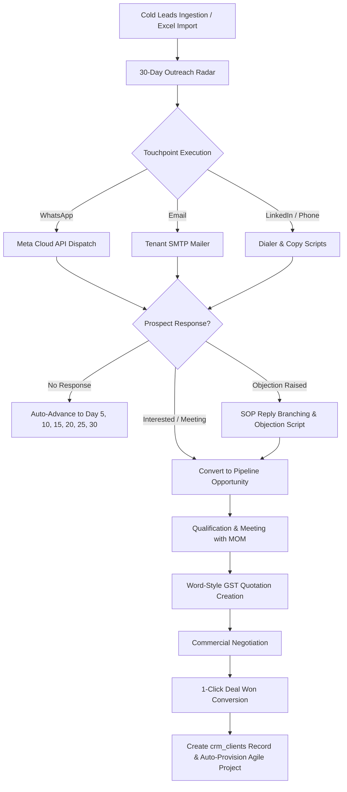

# WOOGIEO / VOOGYO ERP — MASTER SPECIFICATION & MIGRATION BLUEPRINT
**All-in-One Autonomous Business Operating System & Multi-Tenant Enterprise ERP**  
*Document Version: 1.0.0 | Generated: September 2026 | Author: Ravi Shah / RND Technosoft*

---

## 1. Executive Summary & Technology Stack

### 1.1 Project Overview
**WoogieO ERP** (also known in the codebase as **Voogyo ERP**) is an enterprise-grade, multi-tenant Business Operating System designed to replace 7+ disjointed SaaS tools (HubSpot, Zoho One, Jira, Keka/BambooHR, QuickBooks/Zoho Books, PandaDoc, and Lemlist) with a single, deeply unified platform.

Over the past 1.5 weeks of continuous development, the core foundations of multi-tenancy, platform administration, and the entire CRM Outbound Outreach & Sales Automation Suite were engineered, including 30-Day Outreach Cadences, dynamic objection handling, multi-tier industry taxonomies, GST proposal engines, Excel/CSV lead import/export, direct Meta WhatsApp Cloud API & custom SMTP email engines, tamper-proof audit trails, and granular RBAC.

### 1.2 Core Technology Stack
| Layer | Technologies Used | Key Packages & Versions |
| :--- | :--- | :--- |
| **Frontend Framework** | Next.js 14/16 (App Router), React 18 | `next: ^16.3.5`, `react: ^18.3.1`, `react-dom: ^18.3.1` |
| **Language & Typing** | TypeScript 5.9 | `typescript: ^5.9.3`, strict mode enabled |
| **Styling & Icons** | Tailwind CSS 3.4, PostCSS, Lucide Icons | `tailwindcss: ^3.4.19`, `lucide-react: ^0.441.0`, `clsx`, `tailwind-merge` |
| **Database & ORM** | MySQL 8.0+ / MariaDB 10.6+ | `mysql2: ^3.24.4` (Connection pooling with Promises) |
| **Auth & Encryption** | Bcrypt, JSON Web Tokens (JWT) | `bcryptjs: ^2.4.3`, `jsonwebtoken: ^9.0.3` |
| **Spreadsheets & I/O** | SheetJS (XLSX), ExcelJS | `xlsx: ^0.18.5`, `exceljs: ^4.4.0` |
| **Email Communication** | Nodemailer (Tenant Custom SMTP) | `nodemailer: ^10.0.10` |
| **WhatsApp Communication** | Meta WhatsApp Cloud API v19.0 | Direct REST integration (`https://graph.facebook.com/v19.0/`) |
| **Payment Gateway** | Razorpay Node SDK & Webhooks | Razorpay Orders, Subscriptions, Signatures |

### 1.3 Multi-Tenancy Architecture
- **Tenant Isolation**: Every business entity is partitioned using a `tenant_id` foreign key (`CHAR(36)` or `VARCHAR(64)`).
- **Subdomain Routing & Custom Domains**: Tenants are identified by subdomain (`<slug>.voogyo.com`) or verified custom domains (`erp.clientcompany.com`).
- **Control Plane vs. Data Plane**:
  - **Platform HQ (Super Admin)**: Manages subscriptions, packages, platform transactions, global settings, website CMS, and tenant provisioning.
  - **Tenant Workspaces**: Self-contained tenant instances containing CRM, HRMS, Projects, Payroll, Finance, and Operations with tenant-specific SMTP, WhatsApp keys, and custom branding.

---

## 2. Complete Project File & Directory Architecture

Below is the directory map of all files built or modified during the development sprint:

```
voogyo-erp/
├── database/
│   └── migrations/
│       ├── 001_initial_voogyo_schema.sql                       # Core multi-tenancy, CRM base, HRMS, PM, Finance
│       ├── 002_hrms_payroll_projects_finance.sql               # Payroll, payslips, sprint tasks, client vault
│       ├── 003_crm_enterprise_expansion.sql                    # Clients, services master, lost reasons, meetings, quotations
│       ├── 004_crm_templates_and_users.sql                     # Quotation templates master & content body
│       ├── 005_platform_super_admin_schema.sql                 # Super Admin HQ, platform settings, coupons, CMS, invoices
│       ├── 006_crm_sop_masters_and_reorder.sql                 # 30-Day SOP steps, reply branches, industries master, sort_order
│       ├── 007_tenant_organization_and_whatsapp_settings.sql   # WhatsApp Meta Cloud API settings, organization profile fields
│       ├── 008_crm_industry_and_services_update.sql            # Lead industry column, quotation execution roadmap
│       ├── 009_crm_lead_sub_industry.sql                       # Sub-industry column & composite index on crm_leads
│       ├── 010_crm_conversion_channel_and_dynamic_industries.sql # Dynamic crm_industries, crm_sub_industries, conversion channel
│       ├── 011_crm_lead_import_fields.sql                      # Lead import fields (alternate_phone, linkedin_company_url, address)
│       ├── 012_crm_audit_trail_activity_system.sql             # Tamper-proof employee audit logs with JSON diffs
│       ├── run_migration_008.js                                # Node.js migration runner for 008
│       ├── run_migration_009.js                                # Node.js migration runner for 009
│       └── run_migration_010.js                                # Node.js migration runner for 010
│
├── scripts/
│   ├── migrate.js                                              # Multi-migration sequential executor
│   ├── seed.js                                                 # Core database seeder
│   ├── seed_demo_workspace.js                                  # Demo tenant, CRM pipeline, and HRMS seeder
│   ├── seed_5year_tenant_billing.js                            # Historical billing and invoice generator
│   ├── test_db_connection.js                                   # Database connectivity tester
│   └── export_voogyo_bible.js                                  # Documentation exporter
│
├── src/
│   ├── app/
│   │   ├── layout.tsx                                          # Root layout with font imports & metadata
│   │   ├── page.tsx                                            # Public homepage & high-converting SaaS landing page
│   │   ├── globals.css                                         # Global styles, Tailwind base, Word doc print media CSS
│   │   ├── pricing/page.tsx                                    # Public pricing page with Razorpay plan toggles
│   │   ├── signup/page.tsx                                     # Tenant onboarding & workspace registration
│   │   ├── dashboard/page.tsx                                  # Tenant executive dashboard with KPI widgets
│   │   ├── crm/
│   │   │   ├── page.tsx                                        # Central CRM workspace with 7 sub-modules
│   │   │   └── quotations/
│   │   │       ├── new/page.tsx                                # Full Word-style quotation generator (Intra/Inter state GST)
│   │   │       ├── [id]/page.tsx                               # Quotation preview, PDF generator, and client view
│   │   │       └── [id]/edit/page.tsx                          # Full Word-style quotation editor
│   │   ├── emails/page.tsx                                     # Tenant webmail client with Cadence & Inbox folders
│   │   ├── users/page.tsx                                      # Organization Settings, User Directory, RBAC & Integrations
│   │   ├── hrms/page.tsx                                       # Employee directory, attendance, leaves, and recruitment
│   │   ├── payroll/page.tsx                                    # Salary structures, payroll processing & payslips
│   │   ├── projects/page.tsx                                   # Agile sprints, milestones, task Kanban & timesheets
│   │   ├── operations/page.tsx                                 # Client credential vault & SEO keyword trackers
│   │   ├── finance/page.tsx                                    # GST invoicing, payments, expenses & ledger
│   │   ├── ai/page.tsx                                         # AI Business Copilot & autonomous sales assistant
│   │   ├── super-admin/
│   │   │   ├── layout.tsx                                      # Super Admin layout with isolation shell
│   │   │   ├── page.tsx                                        # Super Admin HQ with 15 platform management modules
│   │   │   └── login/page.tsx                                  # Super Admin secure authentication portal
│   │   │
│   │   └── api/v1/                                             # 45+ Production REST Endpoints
│   │       ├── auth/                                           # Workspace login, logout, signup, me
│   │       ├── crm/
│   │       │   ├── leads/                                      # CRUD, bulk operations, webhook, import, export, convert-won
│   │       │   ├── cadence/                                    # 30-Day Outreach Radar, step advancement, seeding
│   │       │   ├── masters/                                    # Stages, pipelines, sources, services, lost-reasons,
│   │       │   │                                               # industries (dynamic CRUD), sub-industries,
│   │       │   │                                               # sop-steps, sop-branches, quotation-categories, reorder
│   │       │   ├── quotations/                                 # Proposal CRUD, calculation engine
│   │       │   ├── quotation-templates/                        # Reusable rich proposal templates
│   │       │   ├── followups/                                  # Task & followup scheduling
│   │       │   ├── meetings/                                   # Google Meet / Zoom events & Minutes of Meeting
│   │       │   ├── activities/                                 # Manual & automated touchpoint logger
│   │       │   ├── audit-logs/                                 # Tamper-proof employee activity audit feed
│   │       │   └── clients/                                    # Converted won clients directory
│   │       ├── tenant/
│   │       │   ├── settings/                                   # Profile, SMTP verify, WhatsApp verify
│   │       │   ├── email/send/                                 # Nodemailer outbound mailer
│   │       │   ├── email/messages/                             # Email folder inbox/sent queries
│   │       │   ├── whatsapp/send/                              # Meta Cloud API message dispatcher
│   │       │   ├── roles/                                      # RBAC permission matrix
│   │       │   └── modules/                                    # Module licensing flags
│   │       ├── super-admin/                                    # 25+ HQ management endpoints (tenants, billing, coupons, etc.)
│   │       ├── billing/razorpay/                               # Order creation, verification, webhooks
│   │       ├── hrms/                                           # Attendance & employee management
│   │       ├── tasks/                                          # Project task management
│   │       └── ai/chat/                                        # Gemini AI Copilot API
│   │
│   ├── components/
│   │   ├── AppShell.tsx                                        # Top-level workspace layout shell with sidebar & topbar
│   │   ├── Sidebar.tsx                                         # Collapsible Zoho-style workspace sidebar
│   │   ├── Topbar.tsx                                          # Tenant brand indicator, search, user dropdown
│   │   ├── VoogyoLogo.tsx                                      # Responsive SVG/Vector brand logo & wordmark
│   │   ├── AIAssistantDrawer.tsx                               # Global slide-over AI copilot
│   │   ├── CreateModal.tsx                                     # Universal Quick-Action modal (Task, Lead, Quote, etc.)
│   │   ├── WebsiteHeader.tsx                                   # Public landing page navigation
│   │   ├── crm/
│   │   │   ├── SLeadCadenceCenter.tsx                          # 30-Day Outreach Funnel (Radar, Queues, Channels, Objections)
│   │   │   ├── PipelineKanban.tsx                              # Sales pipeline Kanban with drag-and-drop & list view
│   │   │   ├── LeadsDirectory.tsx                              # Searchable, filterable leads table with bulk actions
│   │   │   ├── CreateLeadModal.tsx                             # Multi-field lead creation modal with country code selector
│   │   │   ├── ColdLeadImportModal.tsx                         # SheetJS Excel/CSV lead importer with preview grid & batch edit
│   │   │   ├── Lead360Drawer.tsx                               # 360-degree lead detail drawer with timeline, audit & touchpoints
│   │   │   ├── FollowupsAndMeetings.tsx                        # Unified schedule view (calls, meetings, MOM recorder)
│   │   │   ├── QuotationsManager.tsx                           # Quotation list, status tracker & proposal dispatcher
│   │   │   ├── WordDocumentEditor.tsx                          # Word-style proposal editor with letterhead, page breaks & GST
│   │   │   ├── CRMMastersManager.tsx                           # Universal Masters Hub (12 tabs, drag-and-drop ordering)
│   │   │   ├── IndustriesMaster.tsx                            # Dynamic industry & sub-industry CRUD management
│   │   │   ├── LeadIntegrationsCenter.tsx                      # Webhooks, Meta Ads, Google Ads, Zapier integration guide
│   │   │   ├── CrmAuditTrailView.tsx                           # Employee accountability audit trail with before/after diffs
│   │   │   ├── PhoneInputWithCountryCode.tsx                   # Unified phone input with 50+ country flags & dial codes
│   │   │   └── CRMAnalytics.tsx                                # Sales velocity, funnel drop-off & conversion charts
│   │   ├── super-admin/                                        # 22 Super Admin HQ Components
│   │   │   ├── ExecutiveDashboardView.tsx                      # Platform MRR, tenant health, churn metrics
│   │   │   ├── PackagesManagerView.tsx                         # SaaS tier definitions, seat pricing, feature toggles
│   │   │   ├── PlatformBillingCenterView.tsx                   # Platform invoice generator & payment gateway settings
│   │   │   ├── TenantTransactionsView.tsx                      # Real-time transaction ledger & Razorpay sync
│   │   │   ├── SmartUserManagementView.tsx                     # Global user directory & impersonation portal
│   │   │   ├── DomainSubdomainManagerView.tsx                  # Subdomain allocator & SSL/DNS certificate checker
│   │   │   ├── CouponManagementView.tsx                        # Discount codes, expiry rules & redemption limits
│   │   │   ├── PlatformActivityCenterView.tsx                  # Platform-wide security audit logs
│   │   │   ├── PlatformSettingsView.tsx                        # Global platform variables & branding
│   │   │   ├── WebsiteCmsManagerView.tsx                       # CMS page editor, banner management & testimonials
│   │   │   ├── WebsiteSeoAnalyticsView.tsx                     # Meta tag editor, Google Analytics / Search Console config
│   │   │   ├── WebsiteFormBuilderView.tsx                      # Dynamic lead generation form builder
│   │   │   ├── PlatformSupportCenterView.tsx                   # Tenant helpdesk & support ticketing system
│   │   │   ├── PlatformAuditSecurityView.tsx                   # Security vulnerability scanner & session analyzer
│   │   │   ├── TenantRolesBuilderView.tsx                      # System role templates builder
│   │   │   └── SuperAdminAiAssistantView.tsx                   # Executive AI advisor for platform analytics
│   │   └── email/
│   │       └── TenantEmailClientView.tsx                       # Gmail/Outlook-style webmail client for tenant outreach
│   │
│   └── lib/
│       ├── db.ts                                               # MySQL2 promise connection pool & tenant resolver
│       ├── countryCodes.ts                                     # 50+ Country taxonomy with flags, ISO codes & dial codes
│       ├── industryTaxonomy.ts                                 # Dynamic & static industry/sub-industry taxonomy hooks
│       ├── coldMarketingCadence.ts                             # 30-Day Outreach SOP touchpoints, copy & objection branches
│       ├── crmSopMasterService.ts                              # SOP database sync service with fallback auto-seeding
│       ├── crmAuditLogger.ts                                   # Tamper-proof audit logger with client IP & user agent parsing
│       ├── salesTeamHelper.ts                                  # Sales assignee helpers & round-robin lead routing
│       ├── letterheadDefaults.ts                               # Standard corporate letterhead headers & footers
│       ├── superAdminAuth.ts                                   # Super Admin JWT cookie & bcrypt session verification
│       ├── seedColdLeads.ts                                    # High-value B2B cold leads demo dataset
│       └── razorpay.ts                                         # Razorpay order generation & signature validator
│
└── docs/                                                       # 13 Architecture Books & Deployment Manuals
    ├── VOOGYO_DEPLOYMENT_AND_WORKFLOW_GUIDE.md
    ├── 00_founder_vision_and_business_model/
    ├── 01_book_super_admin_and_platform_hq/
    ├── 02_book_hrms_and_recruitment/
    ├── 02_crm_enterprise_module/
    ├── 03_book_crm_and_sales/
    ├── 04_book_operations_core/
    ├── 05_book_project_management/
    ├── 06_book_payroll_and_employee_ops/
    ├── 07_book_operations_suite/
    ├── 08_book_accounts_gst_and_finance_os/
    ├── 09_book_ai_brain_and_autonomous_employees/
    └── 10_book_saas_platform_and_marketplace/
```

---

## 3. Database Architecture & Complete Schema (All 66 Tables)

The system uses a relational MySQL/MariaDB database (`rndtechnosoftin_voogyoERP`). All foreign keys enforce integrity, and indexes are optimized for multi-tenant filtering.

### 3.1 Migration History & Execution Sequence
1. **`001_initial_voogyo_schema.sql`**: Sets up multi-tenancy core (`tenants`, `branches`), licensing (`modules`, `features`, `plans`, `tenant_subscriptions`), RBAC (`roles`, `users`), initial CRM (`crm_pipelines`, `crm_stages`, `crm_leads`, `crm_lead_activities`, `crm_lead_followups`), HRMS, Projects, Finance, and Platform settings.
2. **`002_hrms_payroll_projects_finance.sql`**: Adds salary structures, payroll runs, payslips, sprint tasks, timesheets, client credentials vault, and SEO keyword tracking.
3. **`003_crm_enterprise_expansion.sql`**: Introduces `crm_clients`, `crm_services_master`, `crm_lost_reasons_master`, `crm_meetings`, `crm_quotations`, and `crm_quotation_items`.
4. **`004_crm_templates_and_users.sql`**: Introduces `crm_quotation_templates`, adds `content_body` and `template_id` to `crm_quotations`.
5. **`005_platform_super_admin_schema.sql`**: Introduces Super Admin control plane (`super_admins`, `platform_settings`, `platform_invoices`, `platform_transactions`, `platform_activity_logs`, `platform_support_tickets`, `platform_forms`, `platform_coupons`, `platform_subdomains`, `platform_dns_records`).
6. **`006_crm_sop_masters_and_reorder.sql`**: Adds `crm_sop_steps_master`, `crm_sop_reply_branches_master`, `crm_sop_industries_master`, and adds `sort_order` to all masters.
7. **`007_tenant_organization_and_whatsapp_settings.sql`**: Adds `tenant_whatsapp_settings` and organization profile fields (`currency`, `timezone`, `tax_gstin`, `company_address`, `website_url`) to `tenants`.
8. **`008_crm_industry_and_services_update.sql`**: Adds `industry` to `crm_leads` and `execution_roadmap` to `crm_quotations`.
9. **`009_crm_lead_sub_industry.sql`**: Adds `sub_industry` column and composite index `(tenant_id, industry, sub_industry)` to `crm_leads`.
10. **`010_crm_conversion_channel_and_dynamic_industries.sql`**: Adds `conversion_channel` to `crm_leads` and creates dynamic `crm_industries` and `crm_sub_industries` tables.
11. **`011_crm_lead_import_fields.sql`**: Adds `alternate_phone`, `linkedin_company_url`, `address`, `website_status`, and `internal_notes` to `crm_leads`.
12. **`012_crm_audit_trail_activity_system.sql`**: Creates `crm_audit_logs` for tamper-proof employee activity tracking with JSON before/after diffs.

---

### 3.2 Detailed Schema Breakdown by Domain

#### A. Multi-Tenancy & Platform HQ Core
```sql
-- 1. Tenants (Companies subscribing to the ERP)
CREATE TABLE tenants (
    id CHAR(36) PRIMARY KEY,
    company_name VARCHAR(150) NOT NULL,
    subdomain VARCHAR(63) NOT NULL UNIQUE,
    custom_domain VARCHAR(255) NULL UNIQUE,
    is_custom_domain_verified TINYINT(1) DEFAULT 0,
    primary_contact_name VARCHAR(100) NOT NULL,
    primary_contact_email VARCHAR(150) NOT NULL,
    primary_contact_phone VARCHAR(20) NOT NULL,
    industry_type VARCHAR(60) NOT NULL,
    status VARCHAR(30) NOT NULL DEFAULT 'TRIALING', -- TRIALING, ACTIVE, PAST_DUE, SUSPENDED
    currency VARCHAR(10) DEFAULT 'INR',
    timezone VARCHAR(50) DEFAULT 'Asia/Kolkata',
    tax_gstin VARCHAR(30) NULL,
    company_address TEXT NULL,
    website_url VARCHAR(255) NULL,
    brand_logo_url VARCHAR(500) NULL,
    primary_color VARCHAR(10) DEFAULT '#2563EB',
    secondary_color VARCHAR(10) DEFAULT '#1E40AF',
    max_seats INT DEFAULT 10,
    max_branches INT DEFAULT 1,
    storage_limit_mb INT DEFAULT 5120,
    monthly_ai_token_quota BIGINT DEFAULT 100000,
    monthly_whatsapp_quota INT DEFAULT 500,
    created_at TIMESTAMP DEFAULT CURRENT_TIMESTAMP,
    updated_at TIMESTAMP DEFAULT CURRENT_TIMESTAMP ON UPDATE CURRENT_TIMESTAMP
);

-- 2. Branches (Physical offices / locations per tenant)
CREATE TABLE branches (
    id CHAR(36) PRIMARY KEY,
    tenant_id CHAR(36) NOT NULL,
    branch_name VARCHAR(100) NOT NULL,
    branch_code VARCHAR(30) NOT NULL,
    is_headquarters TINYINT(1) DEFAULT 0,
    address_line1 VARCHAR(255) NULL,
    city VARCHAR(80) NOT NULL,
    state VARCHAR(80) NOT NULL,
    pincode VARCHAR(20) NOT NULL,
    country VARCHAR(80) DEFAULT 'India',
    phone VARCHAR(20) NULL,
    created_at TIMESTAMP DEFAULT CURRENT_TIMESTAMP,
    FOREIGN KEY (tenant_id) REFERENCES tenants(id) ON DELETE CASCADE
);

-- 3. Users & RBAC
CREATE TABLE roles (
    id CHAR(36) PRIMARY KEY,
    tenant_id CHAR(36) NOT NULL,
    role_name VARCHAR(50) NOT NULL,
    role_code VARCHAR(30) NOT NULL,
    description VARCHAR(255) NULL,
    is_system_role TINYINT(1) DEFAULT 0,
    permissions_json JSON NOT NULL,
    created_at TIMESTAMP DEFAULT CURRENT_TIMESTAMP
);

CREATE TABLE users (
    id CHAR(36) PRIMARY KEY,
    tenant_id CHAR(36) NOT NULL,
    branch_id CHAR(36) NULL,
    role_id CHAR(36) NOT NULL,
    email VARCHAR(150) NOT NULL,
    password_hash VARCHAR(255) NOT NULL,
    full_name VARCHAR(100) NOT NULL,
    phone VARCHAR(20) NULL,
    designation VARCHAR(100) NULL,
    avatar_url VARCHAR(500) NULL,
    status VARCHAR(20) DEFAULT 'ACTIVE',
    last_login_at DATETIME NULL,
    created_at TIMESTAMP DEFAULT CURRENT_TIMESTAMP,
    updated_at TIMESTAMP DEFAULT CURRENT_TIMESTAMP ON UPDATE CURRENT_TIMESTAMP,
    UNIQUE KEY uq_tenant_user_email (tenant_id, email)
);
```

#### B. CRM Core & Extended Outbound Engine
```sql
-- 4. Leads Master Table
CREATE TABLE crm_leads (
    id CHAR(36) PRIMARY KEY,
    tenant_id CHAR(36) NOT NULL,
    assigned_user_id CHAR(36) NULL,
    pipeline_id CHAR(36) NOT NULL,
    stage_id CHAR(36) NOT NULL,
    source_id CHAR(36) NULL,
    company_name VARCHAR(150) NOT NULL,
    industry VARCHAR(100) DEFAULT 'general',
    sub_industry VARCHAR(100) DEFAULT NULL,
    contact_person VARCHAR(100) NOT NULL,
    designation VARCHAR(100) NULL,
    email VARCHAR(150) NULL,
    country_code VARCHAR(10) DEFAULT '+91',
    phone VARCHAR(30) NULL,
    alternate_phone VARCHAR(50) NULL,
    whatsapp_number VARCHAR(30) NULL,
    website_url VARCHAR(255) NULL,
    website_status VARCHAR(50) DEFAULT 'ACTIVE',
    linkedin_url VARCHAR(255) NULL,
    linkedin_company_url VARCHAR(500) NULL,
    city VARCHAR(80) NULL,
    state VARCHAR(80) NULL,
    address TEXT NULL,
    estimated_value DECIMAL(15,2) DEFAULT 0.00,
    deal_currency VARCHAR(10) DEFAULT 'INR',
    lead_score INT DEFAULT 0,
    temperature VARCHAR(10) DEFAULT 'COLD', -- COLD, WARM, HOT
    status VARCHAR(20) DEFAULT 'OPEN',     -- OPEN, WON, LOST, JUNK
    conversion_channel VARCHAR(50) DEFAULT NULL,
    lost_reason_id CHAR(36) NULL,
    lost_notes TEXT NULL,
    requirement_brief TEXT NULL,
    internal_notes TEXT NULL,
    custom_attributes JSON NULL,           -- Stores 30-day cadence state & touchpoints history
    last_contacted_at DATETIME NULL,
    next_followup_at DATETIME NULL,
    touchpoints_count INT DEFAULT 0,
    created_at TIMESTAMP DEFAULT CURRENT_TIMESTAMP,
    updated_at TIMESTAMP DEFAULT CURRENT_TIMESTAMP ON UPDATE CURRENT_TIMESTAMP,
    INDEX idx_lead_tenant (tenant_id),
    INDEX idx_lead_stage (tenant_id, stage_id),
    INDEX idx_lead_industry (tenant_id, industry),
    INDEX idx_lead_sub_industry (tenant_id, industry, sub_industry),
    INDEX idx_lead_phone (phone)
);

-- 5. CRM Pipelines & Stages
CREATE TABLE crm_pipelines (
    id CHAR(36) PRIMARY KEY,
    tenant_id CHAR(36) NOT NULL,
    pipeline_name VARCHAR(100) NOT NULL,
    is_default TINYINT(1) DEFAULT 0,
    sort_order INT NOT NULL DEFAULT 0,
    created_at TIMESTAMP DEFAULT CURRENT_TIMESTAMP
);

CREATE TABLE crm_stages (
    id CHAR(36) PRIMARY KEY,
    tenant_id CHAR(36) NOT NULL,
    pipeline_id CHAR(36) NOT NULL,
    stage_name VARCHAR(80) NOT NULL,
    stage_order INT NOT NULL DEFAULT 1,
    win_probability INT DEFAULT 10,
    color_hex VARCHAR(10) DEFAULT '#6B7280',
    is_won_stage TINYINT(1) DEFAULT 0,
    is_lost_stage TINYINT(1) DEFAULT 0,
    created_at TIMESTAMP DEFAULT CURRENT_TIMESTAMP
);

-- 6. Dynamic Industries & Sub-Industries
CREATE TABLE crm_industries (
    id VARCHAR(50) PRIMARY KEY,
    name VARCHAR(100) NOT NULL,
    tenant_id VARCHAR(36) NOT NULL,
    created_at TIMESTAMP DEFAULT CURRENT_TIMESTAMP,
    updated_at TIMESTAMP DEFAULT CURRENT_TIMESTAMP ON UPDATE CURRENT_TIMESTAMP
);

CREATE TABLE crm_sub_industries (
    id VARCHAR(100) PRIMARY KEY,
    industry_id VARCHAR(50) NOT NULL,
    name VARCHAR(100) NOT NULL,
    tenant_id VARCHAR(36) NOT NULL,
    created_at TIMESTAMP DEFAULT CURRENT_TIMESTAMP,
    updated_at TIMESTAMP DEFAULT CURRENT_TIMESTAMP ON UPDATE CURRENT_TIMESTAMP,
    FOREIGN KEY (industry_id) REFERENCES crm_industries(id) ON DELETE CASCADE
);

-- 7. 30-Day Outbound Cadence SOP Steps Master
CREATE TABLE crm_sop_steps_master (
    id VARCHAR(80) PRIMARY KEY,
    tenant_id VARCHAR(80) NOT NULL,
    step_index INT NOT NULL DEFAULT 0,
    day_number INT NOT NULL DEFAULT 1,
    day_offset INT NOT NULL DEFAULT 0,
    title VARCHAR(150) NOT NULL,
    goal VARCHAR(255) NOT NULL,
    channels JSON NOT NULL,                -- ["LINKEDIN", "EMAIL", "WHATSAPP", "PHONE"]
    timing_guide VARCHAR(255) NULL,
    role_note TEXT NULL,
    templates LONGTEXT NOT NULL,           -- JSON containing per-channel message copy with merge tags
    sort_order INT NOT NULL DEFAULT 0,
    is_active TINYINT(1) DEFAULT 1,
    created_at TIMESTAMP DEFAULT CURRENT_TIMESTAMP,
    updated_at TIMESTAMP DEFAULT CURRENT_TIMESTAMP ON UPDATE CURRENT_TIMESTAMP,
    INDEX idx_sop_steps_tenant (tenant_id),
    INDEX idx_sop_steps_order (tenant_id, sort_order)
);

-- 8. Objection Handling Reply Branches Master
CREATE TABLE crm_sop_reply_branches_master (
    id VARCHAR(80) PRIMARY KEY,
    tenant_id VARCHAR(80) NOT NULL,
    branch_key VARCHAR(80) NOT NULL,
    label VARCHAR(150) NOT NULL,
    trigger_condition VARCHAR(255) NOT NULL,
    next_lead_temperature VARCHAR(20) DEFAULT 'WARM',
    suggested_action TEXT NULL,
    recommended_response_script TEXT NULL,
    whatsapp_message TEXT NULL,
    email_subject VARCHAR(255) NULL,
    email_body TEXT NULL,
    sort_order INT NOT NULL DEFAULT 0,
    is_active TINYINT(1) DEFAULT 1,
    created_at TIMESTAMP DEFAULT CURRENT_TIMESTAMP,
    updated_at TIMESTAMP DEFAULT CURRENT_TIMESTAMP ON UPDATE CURRENT_TIMESTAMP,
    INDEX idx_sop_branches_tenant (tenant_id),
    INDEX idx_sop_branches_order (tenant_id, sort_order)
);

-- 9. Quotations & Word-Style Proposals
CREATE TABLE crm_quotations (
    id CHAR(36) PRIMARY KEY,
    tenant_id CHAR(36) NOT NULL,
    lead_id CHAR(36) NOT NULL,
    quotation_number VARCHAR(50) NOT NULL,
    subject VARCHAR(200) NOT NULL,
    content_body LONGTEXT NULL,             -- Rich Word document HTML/JSON
    template_id CHAR(36) NULL,
    tax_type VARCHAR(30) DEFAULT 'INTRA_STATE', -- INTRA_STATE (CGST+SGST) vs INTER_STATE (IGST)
    subtotal DECIMAL(15,2) DEFAULT 0.00,
    discount_percent DECIMAL(5,2) DEFAULT 0.00,
    discount_amount DECIMAL(15,2) DEFAULT 0.00,
    cgst_amount DECIMAL(15,2) DEFAULT 0.00,
    sgst_amount DECIMAL(15,2) DEFAULT 0.00,
    igst_amount DECIMAL(15,2) DEFAULT 0.00,
    total_amount DECIMAL(15,2) DEFAULT 0.00,
    valid_until DATE NULL,
    status VARCHAR(30) DEFAULT 'DRAFT',     -- DRAFT, SENT, ACCEPTED, REJECTED, EXPIRED
    terms_and_conditions TEXT NULL,
    execution_roadmap TEXT NULL,
    created_by CHAR(36) NULL,
    created_at TIMESTAMP DEFAULT CURRENT_TIMESTAMP,
    updated_at TIMESTAMP DEFAULT CURRENT_TIMESTAMP ON UPDATE CURRENT_TIMESTAMP,
    INDEX idx_quotes_tenant (tenant_id),
    INDEX idx_quotes_lead (tenant_id, lead_id)
);

CREATE TABLE crm_quotation_items (
    id CHAR(36) PRIMARY KEY,
    quotation_id CHAR(36) NOT NULL,
    service_id CHAR(36) NULL,
    description TEXT NOT NULL,
    sac_code VARCHAR(20) DEFAULT '998314',
    quantity DECIMAL(10,2) DEFAULT 1.00,
    unit_rate DECIMAL(15,2) DEFAULT 0.00,
    tax_rate DECIMAL(5,2) DEFAULT 18.00,
    amount DECIMAL(15,2) DEFAULT 0.00,
    sort_order INT DEFAULT 1,
    FOREIGN KEY (quotation_id) REFERENCES crm_quotations(id) ON DELETE CASCADE
);

-- 10. Tamper-Proof CRM Audit Trail
CREATE TABLE crm_audit_logs (
    id VARCHAR(64) PRIMARY KEY,
    tenant_id VARCHAR(64) NOT NULL,
    actor_id VARCHAR(64) NOT NULL,
    actor_name VARCHAR(120) NOT NULL,
    actor_email VARCHAR(150) NULL,
    actor_role VARCHAR(50) NULL,
    action_type VARCHAR(30) NOT NULL,       -- ADD, UPDATE, DELETE, CONNECT, LOGIN, LOGOUT, IMPORT, EXPORT
    entity_type VARCHAR(40) NOT NULL,       -- LEAD, CLIENT, QUOTATION, MEETING, FOLLOWUP, CADENCE, AUTH, MASTER
    entity_id VARCHAR(64) NULL,
    entity_name VARCHAR(255) NULL,
    title VARCHAR(255) NOT NULL,
    description TEXT NULL,
    changes_diff JSON NULL,                 -- Before vs After field diff object: { field: { old, new } }
    metadata_json JSON NULL,                -- Context: IP, browser, touchpoint, rows count, channel
    ip_address VARCHAR(45) NULL,
    user_agent TEXT NULL,
    created_at TIMESTAMP DEFAULT CURRENT_TIMESTAMP,
    INDEX idx_audit_tenant_time (tenant_id, created_at),
    INDEX idx_audit_actor (actor_id),
    INDEX idx_audit_action (action_type),
    INDEX idx_audit_entity (entity_type, entity_id)
);
```

#### C. Tenant Communication & Integration Settings
```sql
-- 11. Tenant WhatsApp Settings (Meta Cloud API)
CREATE TABLE tenant_whatsapp_settings (
    id VARCHAR(50) PRIMARY KEY,
    tenant_id CHAR(36) NOT NULL UNIQUE,
    provider VARCHAR(50) DEFAULT 'META_CLOUD_API',
    waba_id VARCHAR(100) NULL,              -- WhatsApp Business Account ID
    phone_number_id VARCHAR(100) NULL,      -- Meta Phone Number ID
    sender_phone_number VARCHAR(30) NULL,   -- e.g. +91 98765 43210
    access_token TEXT NULL,                 -- Permanent System User Token
    webhook_verify_token VARCHAR(100) NULL,
    is_active TINYINT(1) DEFAULT 1,
    created_at TIMESTAMP DEFAULT CURRENT_TIMESTAMP,
    updated_at TIMESTAMP DEFAULT CURRENT_TIMESTAMP ON UPDATE CURRENT_TIMESTAMP,
    FOREIGN KEY (tenant_id) REFERENCES tenants(id) ON DELETE CASCADE
);

-- 12. Tenant SMTP & Webmail
CREATE TABLE tenant_smtp_settings (
    id VARCHAR(50) PRIMARY KEY,
    tenant_id CHAR(36) NOT NULL UNIQUE,
    smtp_host VARCHAR(150) NOT NULL,
    smtp_port INT NOT NULL DEFAULT 587,
    smtp_username VARCHAR(150) NULL,
    smtp_password VARCHAR(255) NULL,
    encryption VARCHAR(20) DEFAULT 'TLS',   -- TLS, SSL, NONE
    sender_name VARCHAR(100) NOT NULL,
    sender_email VARCHAR(150) NOT NULL,
    reply_to VARCHAR(150) NULL,
    is_active TINYINT(1) DEFAULT 1,
    created_at TIMESTAMP DEFAULT CURRENT_TIMESTAMP,
    updated_at TIMESTAMP DEFAULT CURRENT_TIMESTAMP ON UPDATE CURRENT_TIMESTAMP
);

CREATE TABLE tenant_emails (
    id VARCHAR(64) PRIMARY KEY,
    tenant_id CHAR(36) NOT NULL,
    lead_id CHAR(36) NULL,
    folder VARCHAR(30) DEFAULT 'INBOX',     -- INBOX, SENT, CADENCE, DRAFTS, TRASH
    sender_name VARCHAR(100) NOT NULL,
    sender_email VARCHAR(150) NOT NULL,
    recipient_name VARCHAR(100) NOT NULL,
    recipient_email VARCHAR(150) NOT NULL,
    subject VARCHAR(255) NOT NULL,
    body_text TEXT NULL,
    body_html LONGTEXT NULL,
    status VARCHAR(30) DEFAULT 'DELIVERED', -- DELIVERED, QUEUED, FAILED
    is_read TINYINT(1) DEFAULT 0,
    is_starred TINYINT(1) DEFAULT 0,
    cadence_step INT NULL,
    created_at TIMESTAMP DEFAULT CURRENT_TIMESTAMP,
    INDEX idx_emails_tenant_folder (tenant_id, folder)
);
```

#### D. Super Admin HQ & Platform Management Tables
```sql
-- 13. Super Admins & Platform HQ
CREATE TABLE super_admins (
    id VARCHAR(64) PRIMARY KEY,
    full_name VARCHAR(100) NOT NULL,
    email VARCHAR(150) NOT NULL UNIQUE,
    password_hash VARCHAR(255) NOT NULL,
    role VARCHAR(40) NOT NULL DEFAULT 'SUPER_ADMIN',
    is_active TINYINT(1) DEFAULT 1,
    last_login_at DATETIME NULL,
    created_at TIMESTAMP DEFAULT CURRENT_TIMESTAMP
);

CREATE TABLE platform_settings (
    setting_key VARCHAR(100) PRIMARY KEY,
    setting_group VARCHAR(50) NOT NULL,
    setting_value LONGTEXT NULL,
    is_public TINYINT(1) DEFAULT 0,
    updated_at TIMESTAMP DEFAULT CURRENT_TIMESTAMP ON UPDATE CURRENT_TIMESTAMP
);

CREATE TABLE platform_invoices (
    id VARCHAR(64) PRIMARY KEY,
    tenant_id CHAR(36) NOT NULL,
    invoice_number VARCHAR(50) NOT NULL UNIQUE,
    plan_name VARCHAR(100) NOT NULL,
    billing_period VARCHAR(50) NOT NULL,
    subtotal DECIMAL(15,2) NOT NULL,
    tax_amount DECIMAL(15,2) DEFAULT 0.00,
    discount_amount DECIMAL(15,2) DEFAULT 0.00,
    total_amount DECIMAL(15,2) NOT NULL,
    status VARCHAR(30) DEFAULT 'PAID',
    payment_method VARCHAR(50) DEFAULT 'RAZORPAY',
    due_date DATE NULL,
    paid_at DATETIME NULL,
    created_at TIMESTAMP DEFAULT CURRENT_TIMESTAMP
);

CREATE TABLE platform_transactions (
    id VARCHAR(64) PRIMARY KEY,
    tenant_id CHAR(36) NOT NULL,
    invoice_id VARCHAR(64) NULL,
    gateway VARCHAR(30) DEFAULT 'RAZORPAY',
    gateway_payment_id VARCHAR(100) NULL,
    gateway_order_id VARCHAR(100) NULL,
    amount DECIMAL(15,2) NOT NULL,
    currency VARCHAR(10) DEFAULT 'INR',
    status VARCHAR(30) DEFAULT 'CAPTURED',
    created_at TIMESTAMP DEFAULT CURRENT_TIMESTAMP
);

CREATE TABLE platform_coupons (
    id VARCHAR(64) PRIMARY KEY,
    code VARCHAR(50) NOT NULL UNIQUE,
    discount_type VARCHAR(20) DEFAULT 'PERCENTAGE', -- PERCENTAGE or FIXED
    discount_value DECIMAL(10,2) NOT NULL,
    min_order_value DECIMAL(15,2) DEFAULT 0.00,
    max_discount_cap DECIMAL(15,2) NULL,
    valid_from DATETIME NOT NULL,
    valid_until DATETIME NOT NULL,
    usage_limit INT DEFAULT 100,
    times_used INT DEFAULT 0,
    is_active TINYINT(1) DEFAULT 1
);
```

---

## 4. Master Data, Taxonomies & Configuration Systems

### 4.1 Industry & Sub-Industry Taxonomy
The system features a dual-layer industry architecture:
1. **Dynamic Database Persistence (`crm_industries` & `crm_sub_industries`)**: Enables tenants to define custom verticals and sub-verticals via UI without code changes.
2. **Built-in Static Taxonomy Fallback (`src/lib/industryTaxonomy.ts`)**: Provides immediate, rich industry taxonomies across 15+ major sectors.

#### Complete Industry Taxonomy Structure:
- **Manufacturing & Heavy Industry**: Industrial Equipment & Machinery, Packaging & Corrugation, Plastics & Polymers, Chemicals & Petrochemicals, CNC Machining & Fabrication, Electrical Panels & Switchgears.
- **IT, Software & DeepTech**: Custom Web & SaaS Development, Mobile Applications (iOS/Android), Enterprise ERP & CRM Implementation, Cloud Hosting & DevOps, AI Automation & Copilots, Cybersecurity Audits.
- **Healthcare & Pharmaceuticals**: Multi-Specialty Hospitals & Clinics, Pharmaceuticals & Formulations, Diagnostic Laboratories & Imaging, Medical Devices & Surgical Equipment, Ayurveda & Herbal Formulations.
- **Real Estate & Infrastructure**: Residential Township Developers, Commercial Real Estate & Office Parks, Civil Contractors & Turnkey Builders, Architectural Studios & Interior Designers.
- **Retail & E-Commerce**: D2C Consumer Brands, Fashion & Apparel Retailers, Gems & Diamond Jewelry, FMCG & Packaged Foods.
- **Logistics & Supply Chain**: 3PL Warehousing & Fulfillment, Freight Forwarding & Ocean Cargo, Cold Storage Logistics, Fleet Management.
- **Financial & Professional Services**: Chartered Accountancy & Tax Consulting, Corporate Legal Practices, Wealth Management & Investment Banking.

### 4.2 Universal Country Codes Taxonomy (`src/lib/countryCodes.ts`)
Features 50+ countries with ISO codes, country flags, and standard dialing prefixes:
- **Priority Tier**: India (`+91`, `🇮🇳`), USA (`+1`, `🇺🇸`), UK (`+44`, `🇬🇧`), UAE (`+971`, `🇦🇪`), Saudi Arabia (`+966`, `🇸🇦`), Singapore (`+65`, `🇸🇬`), Canada (`+1`, `🇨🇦`), Australia (`+61`, `🇦🇺`), Germany (`+49`, `🇩🇪`), Qatar (`+974`, `🇶🇦`), Kuwait (`+965`, `🇰🇼`), Oman (`+968`, `🇴🇲`), Bahrain (`+973`, `🇧🇭`).
- Integrated into `PhoneInputWithCountryCode.tsx` across the Lead Import Modal, Create Lead Modal, and Lead 360 Drawer.

### 4.3 Sales Pipelines & Stage Milestones Master
Default pipeline: `pipe_rnd_main` ("Enterprise Sales Pipeline"):
1. **New Lead Ingested** (`order: 1`, `prob: 10%`, `#3B82F6`): Uncontacted inbound/imported leads.
2. **Contacted / Outreach Active** (`order: 2`, `prob: 25%`, `#6366F1`): Active within the 30-day multi-channel funnel.
3. **Requirement Qualified** (`order: 3`, `prob: 40%`, `#8B5CF6`): Discovery call held, scope identified.
4. **Proposal / Quote Sent** (`order: 4`, `prob: 65%`, `#EC4899`): Formal GST proposal dispatched.
5. **Commercial Negotiation** (`order: 5`, `prob: 80%`, `#F59E0B`): Final pricing, payment terms & timeline alignment.
6. **Deal Won / Client Onboarded** (`order: 6`, `prob: 100%`, `#10B981`): 1-Click conversion into `crm_clients` and Projects.
7. **Deal Lost / Nurture Pool** (`order: 7`, `prob: 0%`, `#EF4444`): Tagged with Lost Reason for future retargeting.

### 4.4 Services Master Catalogue
Configured for Indian SAC codes and GST compliance:
- **Custom Website Design & Web Application** (SAC: `998314`, Rate: `₹45,000`, GST: 18%)
- **Full-Stack SaaS / Enterprise ERP Development** (SAC: `998314`, Rate: `₹1,50,000`, GST: 18%)
- **First-Page Google SEO & Organic Traffic Suite** (SAC: `998315`, Rate: `₹25,000/mo`, GST: 18%)
- **Meta Ads & Performance Marketing Management** (SAC: `998315`, Rate: `₹20,000/mo`, GST: 18%)
- **Corporate Branding, Logo & Identity Design** (SAC: `998311`, Rate: `₹25,000`, GST: 18%)
- **Annual Maintenance Retainer (AMC) & DevOps** (SAC: `998313`, Rate: `₹15,000/mo`, GST: 18%)

### 4.5 Lost Reasons Master
- Price Too High / Budget Constraints
- Competitor Chosen (Lower Cost)
- Competitor Chosen (Prior Relationship)
- Requirement Postponed / Internal Priority Shift
- Project Cancelled by Board
- Non-Responsive / Cold Lead Abandoned
- Incompatible Technology Stack

---

## 5. Messages, Scripts & Cadence Content (Complete Wordings)

### 5.1 Dynamic Merge Tag Variable Engine
The system supports 8 dynamic merge tags that interpolate prospect data in real time:
- `{{First Name}}`: Lead's first name (e.g., "Rahul")
- `{{Last Name}}`: Lead's surname (e.g., "Sharma")
- `{{Full Name}}`: First + Last name (e.g., "Rahul Sharma")
- `{{Company Name}}`: Company name (e.g., "TechCorp Pvt Ltd")
- `{{Assignee Name}}`: Sales Head / Account Executive (default: "Saloni Shah")
- `{{Designation}}`: Lead's role (e.g., "Managing Director")
- `{{Industry}}`: Vertical (e.g., "Packaging & Polymers")
- `{{Portfolio Link}}`: Live portfolio / case study URL

---

### 5.2 The 30-Day Multi-Channel Outbound Marketing SOP Protocol

#### Day 1: "Triple Platform Launch"
- **Objective**: Make the first impression across LinkedIn, Email, and WhatsApp.
- **Timing Guide**: LinkedIn (9:30 AM), Email (11:00 AM), WhatsApp (4:00 PM).
- **LinkedIn Connect Script**:
  > Hi {{First Name}},  
  > Came across {{Company Name}} while exploring businesses in the {{Industry}} sector.  
  > Would love to connect and stay in touch regarding technology and digital growth.
- **Cold Email Copy**:
  > **Subject**: Connecting with {{Company Name}} | RND Technosoft  
  > **Body**:  
  > Dear {{First Name}},  
  > 
  > I'm {{Assignee Name}} from RND Technosoft, Vapi.  
  > We help businesses improve their digital presence through websites, SEO, branding, software development, and AI automation.  
  > 
  > Sharing our company profile for your reference:  
  > 📁 {{Portfolio Link}}  
  > 
  > We would be delighted to understand how {{Company Name}} manages its digital and web operations today.  
  > 
  > Warm regards,  
  > {{Assignee Name}} | RND Technosoft  
  > 📞 +91 98765 43210
- **WhatsApp Icebreaker Copy**:
  > Hello {{First Name}} Sir/Madam! 🙏  
  > 
  > I'm {{Assignee Name}} from RND Technosoft. We specialize in websites, custom software, and Google SEO ranking for businesses in the {{Industry}} sector.  
  > 
  > Just wanted to share our work portfolio: {{Portfolio Link}}  
  > 
  > Looking forward to being connected! 😊

---

#### Day 5: "Trust & Portfolio Showcase"
- **Objective**: Build trust by showcasing relevant case studies without aggressive selling.
- **Channels**: WhatsApp & Email.
- **Email Copy**:
  > **Subject**: How similar {{Industry}} companies scaled their customer acquisition | RND Technosoft  
  > **Body**:  
  > Dear {{First Name}},  
  > 
  > Hope you're having a productive week.  
  > 
  > I wanted to share a quick glimpse of how we recently helped companies in your sector modernize their web presence, achieve under-2-second loading times, and capture high-intent Google search inquiries.  
  > 
  > You can explore our recent live projects here:  
  > 🌐 {{Portfolio Link}}  
  > 
  > Would love to share some quick ideas tailored specifically for {{Company Name}} if you have 5 minutes this week.  
  > 
  > Best regards,  
  > {{Assignee Name}}
- **WhatsApp Copy**:
  > Hi {{First Name}}! Hope you're having a great day.  
  > 
  > Here is a quick 1-minute look at some of the web & software solutions we recently delivered for the {{Industry}} sector: {{Portfolio Link}}  
  > 
  > Happy to answer any questions whenever convenient! 👍

---

#### Day 10: "Business Value & Digital Insight"
- **Objective**: Deliver genuine value by identifying actionable improvements.
- **Channels**: Email & WhatsApp.
- **Email Copy**:
  > **Subject**: Quick digital insight for {{Company Name}}  
  > **Body**:  
  > Dear {{First Name}},  
  > 
  > While analyzing leading brands in the {{Industry}} space, we noticed 3 key elements that separate high-converting websites from standard brochures:  
  > 1. Mobile First Speed (< 2.5s Core Web Vitals) to retain 40%+ more traffic.  
  > 2. Specific landing pages for high-margin service keywords on Google Page 1.  
  > 3. Seamless WhatsApp integration for instant inquiry captures.  
  > 
  > We ran a preliminary check on {{Company Name}} and spotted a couple of easy wins. Would you like me to send over a brief summary?  
  > 
  > Warm regards,  
  > {{Assignee Name}}
- **WhatsApp Copy**:
  > Hi {{First Name}}, did you know that 68% of B2B buyers now research suppliers on mobile before initiating an inquiry?  
  > 
  > Having a fast, Google-optimized site makes a massive difference in conversion. Would love to share a free speed & visibility checklist for {{Company Name}} if interested!

---

#### Day 15: "Engagement & Free Audit Offer"
- **Objective**: Spark two-way dialogue by offering a no-cost, high-value asset.
- **Channels**: LinkedIn & WhatsApp.
- **LinkedIn Script**:
  > Hi {{First Name}}, hope things are going great at {{Company Name}}!  
  > We are offering complimentary Website Speed & Google Search Visibility audits this month for select {{Industry}} businesses.  
  > Would it be helpful if our tech team audited {{Company Name}}'s web presence and shared a 1-page report? No obligations whatsoever.
- **WhatsApp Copy**:
  > Hello {{First Name}}! We are preparing 3 free Digital Audit Reports for businesses in your sector this week.  
  > 
  > The report highlights site loading speeds, Google search visibility, and mobile experience. Shall I prepare one for {{Company Name}}? Reply "YES" and I'll send it over! 🚀

---

#### Day 20: "Social Proof & Client Success Story"
- **Objective**: Showcase verifiable ROI and client testimonials.
- **Channels**: Email & WhatsApp.
- **Email Copy**:
  > **Subject**: Case Study: 180% inquiry boost in the {{Industry}} sector  
  > **Body**:  
  > Dear {{First Name}},  
  > 
  > Results speak louder than promises.  
  > 
  > When one of our manufacturing clients came to us, their website was loading slowly and generating virtually zero organic leads. Within 90 days of redesign and targeted SEO:  
  > • Page speed improved from 6.8s to 1.4s.  
  > • Organic Google search traffic surged by 210%.  
  > • Inbound quote requests increased by 180%.  
  > 
  > We bring this exact engineering precision to every project we undertake.  
  > 
  > Are you free for a brief 10-minute discovery call this Thursday at 3:00 PM?  
  > 
  > Best regards,  
  > {{Assignee Name}}
- **WhatsApp Copy**:
  > Hi {{First Name}}, sharing a quick milestone: We recently helped a client in your industry increase their monthly inquiries by 180% with our modern web & SEO architecture.  
  > 
  > Would love to discuss how we can replicate this for {{Company Name}}!

---

#### Day 25: "Discovery Qualification Call"
- **Objective**: Secure a calendar invite or direct telephone conversation.
- **Channels**: Phone Call & WhatsApp.
- **Phone Talking Points**:
  > 1. Introduction: "Good afternoon {{First Name}}, this is {{Assignee Name}} calling from RND Technosoft."  
  > 2. Context: "I've sent a couple of messages regarding your digital presence and wanted to quickly introduce myself directly."  
  > 3. Discovery Question: "Are you currently looking to upgrade your website, improve Google search rankings, or automate any internal operations this quarter?"  
  > 4. Closing: "If you have 10 minutes next Tuesday, I'd love to show you our work demo via Google Meet."
- **WhatsApp Follow-up Copy**:
  > Hi {{First Name}}, tried reaching you briefly over the phone earlier.  
  > 
  > Whenever you have 5-10 minutes, I would love to connect for a quick introductory call to explore how we can support {{Company Name}}'s growth. Let me know what time works best for you! 📞

---

#### Day 30: "Respectful Exit & Door Opener"
- **Objective**: Professional "breakup" email that preserves goodwill and often yields responses.
- **Channels**: Email, WhatsApp & LinkedIn.
- **Email Breakup Copy**:
  > **Subject**: Closing our file for {{Company Name}}?  
  > **Body**:  
  > Dear {{First Name}},  
  > 
  > I've reached out a few times over the past month regarding digital solutions and web development for {{Company Name}}. Since I haven't heard back, I assume this isn't a priority right now, which is completely understandable!  
  > 
  > I will pause my outreach for now so as not to clutter your inbox.  
  > 
  > Should you ever need assistance with website redesigns, Google SEO ranking, custom ERP systems, or branding in the future, please feel free to reach out anytime.  
  > 
  > Wishing you and {{Company Name}} continued success!  
  > 
  > Warmest regards,  
  > {{Assignee Name}} | RND Technosoft  
  > 🌐 https://rndtechnosoft.in | 📞 +91 98765 43210
- **WhatsApp Copy**:
  > Hi {{First Name}}, I understand you're busy and this may not be the right time. I won't follow up further, but please feel free to keep my contact saved for any future website, software, or SEO needs. Wishing you all the best! 🙏✨

---

### 5.3 Objection Handling Scripts & Branching Messages

#### Objection 1: "Already Have a Website"
- **Trigger**: Prospect says: *"We already have a website"* or *"Site is already made"*.
- **New Lead Temperature**: `WARM`
- **Recommended Phone Script**:
  > *"Understood {{First Name}}! Most of our premier clients already had established websites when we first connected. We usually assist existing businesses with modern UI/UX redesign & mobile speed optimization (< 2 sec loading), Google First-Page SEO ranking to capture active buyer searches, or custom client/dealer portals and ERP automation to eliminate manual work. If you're open to it, I can share a quick 3-minute audit highlighting opportunities for {{Company Name}}'s current website. Would you like me to send it over?"*
- **WhatsApp Copy**:
  > Understood {{First Name}}! Most of our clients already had websites when we connected. We usually help with mobile speed optimization, Google First-Page SEO ranking, or building custom client/ERP portals. If you'd like, I can run a quick complimentary speed & SEO health check on your current site and send it here. Would that be helpful? 😊
- **Email Subject**: Complimentary website performance & Google visibility check for {{Company Name}}

#### Objection 2: "Send Details / Share Profile"
- **Trigger**: Prospect says: *"Send me your profile"* or *"Share your portfolio on WhatsApp/email"*.
- **New Lead Temperature**: `WARM`
- **Recommended Phone Script**:
  > *"I will immediately dispatch our corporate credentials deck and live portfolio link. To make sure I include the most relevant case studies, are you primarily interested in website revamps, Google search ranking, or custom business software?"*
- **WhatsApp Copy**:
  > Hi {{First Name}}! Delighted to share our credentials:  
  > 📁 Live Portfolio: {{Portfolio Link}}  
  > 💼 Services: Custom Web Apps, SEO, AI Copilots, Mobile Apps  
  > 🏢 Locations: Vapi, Surat, Mumbai  
  > I'll also drop our detailed presentation to your email. What is the best email address to send it to?
- **Email Subject**: Corporate Credentials & Live Project Portfolio | RND Technosoft for {{Company Name}}

#### Objection 3: "Call Me Later / Busy Right Now"
- **Trigger**: Prospect says: *"I am driving / in a meeting, call me next week"*.
- **New Lead Temperature**: `WARM`
- **Recommended Phone Script**:
  > *"Completely understand {{First Name}}. I will make a note to call you next Tuesday at 11:30 AM. Have a wonderful day ahead!"*
- **WhatsApp Copy**:
  > Noted {{First Name}}! I will reconnect with you early next week. Have a great day ahead! 👍

#### Objection 4: "Interested in SEO / Google Ranking"
- **Trigger**: Prospect says: *"Do you do SEO?"* or *"How to get on Google First Page?"*.
- **New Lead Temperature**: `HOT`
- **Recommended Phone Script**:
  > *"Absolutely {{First Name}}. We specialize in high-intent commercial B2B SEO. We identify exactly what your potential buyers are searching for on Google, optimize your site architecture, and secure top rankings for high-margin keywords. Let me analyze your top 5 competitors and send you a keyword opportunity matrix."*
- **WhatsApp Copy**:
  > Hi {{First Name}}! Yes, SEO is one of our primary core capabilities. We specialize in ranking B2B businesses on Google First Page for commercial buyer searches. Can you share 2-3 of your main products/services? I will prepare a quick competitor search visibility breakdown for you! 📈

#### Objection 5: "Not Interested / No Requirement"
- **Trigger**: Prospect says: *"Not interested"* or *"We don't need any services"*.
- **New Lead Temperature**: `COLD`
- **Recommended Phone Script**:
  > *"Thank you for your candid response, {{First Name}}. I will update our records so you don't receive further follow-ups. If your priorities ever change down the road, please feel free to reach out. Have a fantastic day!"*
- **WhatsApp Copy**:
  > Understood {{First Name}}, thank you for letting me know! I will make sure not to disturb you further. Keep our contact saved just in case you need tech or web assistance in the future. Have a wonderful day! 🙏

---

## 6. Comprehensive API Endpoint Specifications

Below are the key production REST endpoints implemented in the system:

### 6.1 Authentication & Multi-Tenancy
| Method | Endpoint | Description | Key Body / Query Parameters |
| :--- | :--- | :--- | :--- |
| `POST` | `/api/v1/auth/login` | Workspace user login with bcrypt | `{ email, password, tenant_id? }` |
| `POST` | `/api/v1/auth/signup` | New tenant workspace self-onboarding | `{ company_name, subdomain, name, email, password, phone, industry }` |
| `GET` | `/api/v1/auth/me` | Fetch active session & tenant identity | Headers / JWT Cookie |
| `POST` | `/api/v1/auth/logout` | Clear session cookie | None |

### 6.2 CRM Leads & Outbound Management
| Method | Endpoint | Description | Key Body / Query Parameters |
| :--- | :--- | :--- | :--- |
| `GET` | `/api/v1/crm/leads` | Filterable leads directory | `?search=&pipeline_id=&stage_id=&industry=&temperature=&page=&limit=` |
| `POST` | `/api/v1/crm/leads` | Create new lead with auto-assignment | `{ company_name, contact_person, email, phone, country_code, industry, sub_industry, estimated_value, source_id, stage_id }` |
| `GET` | `/api/v1/crm/leads/[id]` | Full 360 lead profile with timeline | Lead ID in path |
| `PATCH` | `/api/v1/crm/leads/[id]` | Update lead fields & log audit diff | `{ stage_id?, temperature?, next_followup_at?, ... }` |
| `DELETE`| `/api/v1/crm/leads/[id]` | Soft / Hard delete lead | Lead ID in path |
| `POST` | `/api/v1/crm/leads/bulk` | Bulk reassign, update stage, or delete | `{ lead_ids: [], action: 'REASSIGN'\|'STAGE'\|'DELETE', payload: {} }` |
| `POST` | `/api/v1/crm/leads/import`| Bulk import leads with deduplication | `{ leads: [ParsedLeadRow], deduplicateBy: 'EMAIL'\|'PHONE' }` |
| `GET` | `/api/v1/crm/leads/import/template` | Download dynamic sample Excel template | Returns `.xlsx` binary with dropdown guides |
| `GET` | `/api/v1/crm/leads/export`| Export filtered leads to `.xlsx` | `?pipeline_id=&industry=&format=xlsx` |
| `POST` | `/api/v1/crm/leads/webhook`| Inbound webhook for Meta/Google Ads | Inbound JSON payload from Meta/Zapier |
| `POST` | `/api/v1/crm/leads/[id]/convert-won` | Convert deal into Client & Project | `{ lead_id, company_name, deal_value, ... }` |

### 6.3 30-Day Cadence Engine
| Method | Endpoint | Description | Key Body / Query Parameters |
| :--- | :--- | :--- | :--- |
| `GET` | `/api/v1/crm/cadence` | Outreach Radar (Due today, overdue, stats) | `?industry=&sub_industry=&channel=` |
| `POST` | `/api/v1/crm/cadence` | Advance lead touchpoint or branch objection | `{ leadId, action: 'COMPLETE_STEP'\|'BRANCH_OBJECTION', stepIndex, notes, branchKey }` |
| `POST` | `/api/v1/crm/cadence/seed` | Seed default 30-day cold cadence leads | `{ count: 20 }` |

### 6.4 CRM Masters & Reorder
| Method | Endpoint | Description | Key Body / Query Parameters |
| :--- | :--- | :--- | :--- |
| `GET/POST` | `/api/v1/crm/masters/sop-steps` | CRUD 30-day SOP steps | `{ title, goal, day_number, channels, templates, ... }` |
| `GET/POST` | `/api/v1/crm/masters/sop-branches`| CRUD objection reply branches | `{ branch_key, label, trigger_condition, whatsapp_message, email_body, ... }` |
| `GET/POST` | `/api/v1/crm/masters/industries` | Dynamic industries CRUD | `{ name }` |
| `GET/POST` | `/api/v1/crm/masters/industries/sub` | Dynamic sub-industries CRUD | `{ industry_id, name }` |
| `GET/POST` | `/api/v1/crm/masters/pipelines` | CRUD sales pipelines | `{ pipeline_name, is_default }` |
| `GET/POST` | `/api/v1/crm/masters/stages` | CRUD pipeline stages | `{ pipeline_id, stage_name, stage_order, win_probability, color_hex }` |
| `GET/POST` | `/api/v1/crm/masters/sources` | CRUD lead sources | `{ source_name }` |
| `GET/POST` | `/api/v1/crm/masters/services` | CRUD services catalogue | `{ name, category, sac_code, default_rate }` |
| `GET/POST` | `/api/v1/crm/masters/lost-reasons` | CRUD deal lost reasons | `{ reason_name }` |
| `POST` | `/api/v1/crm/masters/reorder` | Drag-and-drop sort order updater | `{ entityType: 'sop_steps'\|'stages'\|'sources'\|'services', orderedIds: [] }` |

### 6.5 Quotations, Communications & Audit
| Method | Endpoint | Description | Key Body / Query Parameters |
| :--- | :--- | :--- | :--- |
| `GET/POST` | `/api/v1/crm/quotations` | List / create GST proposals | `{ lead_id, subject, tax_type, items: [], terms, roadmap }` |
| `GET/PATCH`| `/api/v1/crm/quotations/[id]` | Fetch / update proposal details | Quotation ID in path |
| `GET/POST` | `/api/v1/crm/quotation-templates` | CRUD rich proposal templates | `{ name, category, intro_content, terms_content, default_items }` |
| `POST` | `/api/v1/tenant/whatsapp/send` | Dispatch WhatsApp via Meta Cloud API | `{ to: '+91...', message: '...', leadId? }` |
| `POST` | `/api/v1/tenant/email/send` | Dispatch email via tenant custom SMTP | `{ to, subject, text, html, leadId?, advanceCadence? }` |
| `GET/POST` | `/api/v1/tenant/settings` | Get / update organization profile & SMTP/WA | `{ company_name, currency, timezone, gstin, smtp: {}, whatsapp: {} }` |
| `GET` | `/api/v1/crm/audit-logs` | Tamper-proof employee activity feed | `?actor_id=&action_type=&entity_type=&date_from=&format=json\|csv` |

---

## 7. Key Workflows & Business Logic

### 7.1 Cold Outreach to Won Deal Lifecycle


### 7.2 Quotation Calculation & Indian GST Engine
The quotation engine dynamically calculates taxes based on supplier and customer locations:
- **Intra-State GST (Within Same State, e.g., Gujarat to Gujarat)**:
  $$\text{CGST} = \text{Taxable Amount} \times 9\%$$
  $$\text{SGST} = \text{Taxable Amount} \times 9\%$$
  $$\text{Total Tax} = \text{CGST} + \text{SGST} = 18\%$$
- **Inter-State GST (Between Different States, e.g., Gujarat to Maharashtra)**:
  $$\text{IGST} = \text{Taxable Amount} \times 18\%$$
- **Commercial Discounts**: Supports both percentage discounts (`subtotal * (discount_percent / 100)`) and flat rupee deductions.
- **Word-Style Document Layout**: Emits clean CSS page breaks (`page-break-after: always`), fixed corporate headers/footers, and print styling for client-ready PDF generation.

### 7.3 Tamper-Proof Audit Trail Logging Engine
Every employee action across the CRM triggers an asynchronous background audit call via `src/lib/crmAuditLogger.ts`:
- Captures `actor_id`, `actor_name`, `actor_email`, and `actor_role`.
- Extracts client IP address via `x-forwarded-for`, `x-real-ip`, or socket connection.
- Computes before vs. after JSON diff: `{ field_name: { old: previous_val, new: updated_val } }`.
- Logs browser User-Agent and device context.
- Exports to CSV for regulatory and compliance audits.

---

## 8. Complete Migration & Switch Blueprint (Step-by-Step)

To switch this exact architecture, database, and codebase to your new project repository, follow these precise steps:

### Step 1: Initialize New Project & Install Dependencies
1. Initialize your new project repository.
2. Ensure your `package.json` includes the following dependencies:
```json
{
  "name": "your-new-erp-project",
  "version": "1.0.0",
  "scripts": {
    "dev": "next dev -p 3001",
    "build": "next build",
    "start": "next start -p 3001"
  },
  "dependencies": {
    "@types/bcryptjs": "^2.4.6",
    "@types/jsonwebtoken": "^9.0.10",
    "@types/node": "^20.19.43",
    "@types/nodemailer": "^8.0.2",
    "@types/react": "^18.3.31",
    "@types/react-dom": "^18.3.7",
    "autoprefixer": "^10.6.0",
    "bcryptjs": "^2.4.3",
    "clsx": "^2.1.1",
    "dotenv": "^17.4.2",
    "exceljs": "^4.4.0",
    "jsonwebtoken": "^9.0.3",
    "lucide-react": "^0.441.0",
    "mysql2": "^3.24.4",
    "next": "^16.3.5",
    "nodemailer": "^10.0.10",
    "postcss": "^8.5.28",
    "react": "^18.3.1",
    "react-dom": "^18.3.1",
    "tailwind-merge": "^2.6.1",
    "tailwindcss": "^3.4.19",
    "typescript": "^5.9.3",
    "xlsx": "^0.18.5"
  }
}
```
3. Run `npm install` to install all libraries.

---

### Step 2: Environment Variables Setup (`.env`)
Create a `.env` file in the root directory:
```env
# Database Configuration (MySQL 8.0+ / MariaDB 10.6+)
DB_HOST=crystal.herosite.pro
DB_PORT=3306
DB_USER=rndtechnosoftin_voogyoERP_usr
DB_PASSWORD=your_secure_db_password
DB_NAME=rndtechnosoftin_voogyoERP

# Super Admin Session Secret
JWT_SECRET=voogyo_super_secret_jwt_key_2026_change_in_production
SUPER_ADMIN_PASSWORD=Voogyo@2026!

# Public URLs
NEXT_PUBLIC_APP_URL=http://localhost:3001
NEXT_PUBLIC_API_URL=http://localhost:3001/api/v1
```

---

### Step 3: Run Database Migrations in Sequential Order
Execute the 12 SQL migrations into your MySQL/MariaDB database in this exact order:
```bash
mysql -h $DB_HOST -u $DB_USER -p $DB_NAME < database/migrations/001_initial_voogyo_schema.sql
mysql -h $DB_HOST -u $DB_USER -p $DB_NAME < database/migrations/002_hrms_payroll_projects_finance.sql
mysql -h $DB_HOST -u $DB_USER -p $DB_NAME < database/migrations/003_crm_enterprise_expansion.sql
mysql -h $DB_HOST -u $DB_USER -p $DB_NAME < database/migrations/004_crm_templates_and_users.sql
mysql -h $DB_HOST -u $DB_USER -p $DB_NAME < database/migrations/005_platform_super_admin_schema.sql
mysql -h $DB_HOST -u $DB_USER -p $DB_NAME < database/migrations/006_crm_sop_masters_and_reorder.sql
mysql -h $DB_HOST -u $DB_USER -p $DB_NAME < database/migrations/007_tenant_organization_and_whatsapp_settings.sql
mysql -h $DB_HOST -u $DB_USER -p $DB_NAME < database/migrations/008_crm_industry_and_services_update.sql
mysql -h $DB_HOST -u $DB_USER -p $DB_NAME < database/migrations/009_crm_lead_sub_industry.sql
mysql -h $DB_HOST -u $DB_USER -p $DB_NAME < database/migrations/010_crm_conversion_channel_and_dynamic_industries.sql
mysql -h $DB_HOST -u $DB_USER -p $DB_NAME < database/migrations/011_crm_lead_import_fields.sql
mysql -h $DB_HOST -u $DB_USER -p $DB_NAME < database/migrations/012_crm_audit_trail_activity_system.sql
```
*(Alternatively, run `node scripts/migrate.js` which executes them sequentially via Node.js).*

---

### Step 4: Seed Demo Tenant, Super Admin & Outbound Masters
Run the seeding scripts to populate initial demo data:
```bash
node scripts/seed_demo_workspace.js
```
This script provisions:
1. **Demo Tenant**: `tenant_rnd_001` ("RND Technosoft") with subdomain `rnd`.
2. **Super Admin**: `superadmin@voogyo.com` (password: `Voogyo@2026!`).
3. **Workspace Users**: Ravi Shah (`ravi@rndtechnosoft.com`), Saloni Shah (`saloni@rndtechnosoft.com`).
4. **CRM Pipelines & Stages**: Enterprise Sales Pipeline with 7 default stages.
5. **Masters**: Services catalogue, lost reasons, quotation categories, and proposal templates.
6. **30-Day SOP Steps**: 7 touchpoint steps with multi-channel copy.
7. **Objection Branches**: 5 dynamic objection response scripts.
8. **Sample Leads**: 20 enriched B2B leads actively enrolled in the outreach funnel.

---

### Step 5: Transfer Core Directories
Copy the following directory blocks into your new project:
1. `src/lib/`: Database pool, auth helpers, taxonomy dictionaries, audit logger, Razorpay gateway.
2. `src/components/crm/`: All 14 CRM components (Cadence center, Kanban, Masters, Quotation editor, Import modal, etc.).
3. `src/components/super-admin/`: All 22 Super Admin HQ views.
4. `src/components/email/`: Webmail client view.
5. `src/components/AppShell.tsx`, `Sidebar.tsx`, `Topbar.tsx`, `VoogyoLogo.tsx`, `CreateModal.tsx`.
6. `src/app/api/v1/`: All REST API routes.
7. `src/app/crm/`, `src/app/users/`, `src/app/emails/`, `src/app/super-admin/`, `src/app/dashboard/`.
8. `src/app/globals.css`: Global styles and Word document print media CSS.

---

### Step 6: Post-Migration Verification Checklist
- [ ] Run `npm run dev` and confirm the server starts on `http://localhost:3001`.
- [ ] Log in as Super Admin at `/super-admin/login` using `superadmin@voogyo.com` / `Voogyo@2026!`.
- [ ] Navigate to `/crm` and verify the **Client Outreach (Radar)** loads active leads.
- [ ] Navigate to `/crm?tab=masters` and verify all 12 master tabs load data (Industries, Stages, Sources, Services, SOP Steps, SOP Branches).
- [ ] Test the Word-Style Quotation Creator at `/crm/quotations/new` and verify CGST/SGST vs. IGST calculations.
- [ ] Navigate to `/users?tab=integrations` and test the SMTP and WhatsApp Cloud API configuration interfaces.
- [ ] Check `/crm?tab=audit-trail` and confirm employee actions are logged with before/after JSON diffs.

---
*End of Master Specification & Migration Blueprint.*
